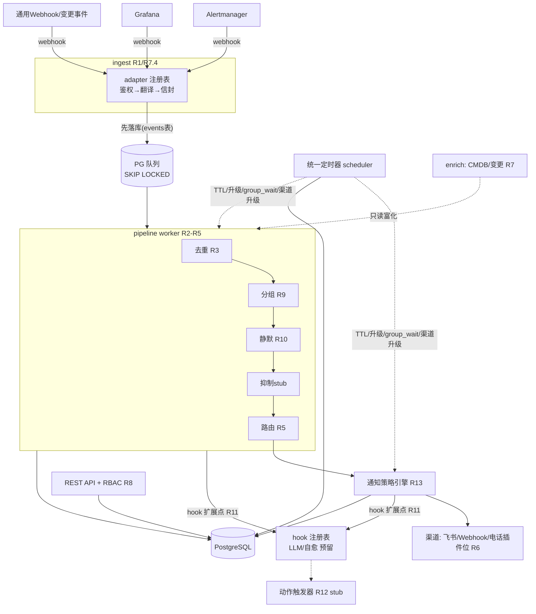

# Design Document — alert-system-mvp

## Overview

本设计实现 requirements.md 定义的告警管理平台 MVP：以 Go 单体服务 + PostgreSQL 为核心，实现「接入 → 归一化 → 去重 → 分组 → 静默 → 路由 → 通知（渠道升级/人员升级）」管道，并为 CMDB 图、LLM 分析、自愈触发预留扩展点。

**架构风格**：单体 + 六边形（ports & adapters）。MVP 规模（≥100 events/s、内部平台）不需要微服务；六边形保证 D2/D6 要求的「adapter 可插拔、核心域不依赖具体实现」，未来拆分有清晰切缝。

### 术语表：去重 ≠ 分组 ≠ 关联收敛（评审意见修订）

三者常被笼统称为「收敛」，本设计严格区分，文档中不再使用宽泛的「收敛」一词：

| 术语 | 判定依据 | 作用层与效果 | 落点 |
|------|---------|-------------|------|
| **去重 Deduplication** | fingerprint **完全相同**（同一问题反复触发） | 告警层：合并为同一条告警，dedup_count +1，不产生新通知 | R3，MVP |
| **分组 Grouping** | fingerprint 不同，但命中同一路由且 `group_by` 标签值相同（同类问题批量发生，如一批节点宕机） | 通知层：告警仍是 N 条独立记录，仅通知聚合为 1 条 | R9，MVP |
| **关联收敛 Correlation** | fingerprint 与标签均可不同，依据拓扑（CMDB 图）/时间窗/AI 推断因果关系（如交换机故障引发 50 条下游告警） | 事件层：跨告警归并、指向根因候选 | 二期（依赖 R7 CMDB 图 + R11 LLM 标注） |

管道中的处理顺序体现层次：去重发生在告警创建时（最早），分组发生在通知前，关联收敛未来作为旁路分析（hook 扩展点）产出建议性归并。

### 技术选型（推荐 + 取舍）

| 选型 | 推荐 | 关键取舍 |
|------|------|---------|
| 语言 | Go 1.24+ | 既定（项目路径），生态匹配（Alertmanager/GoAlert 同栈，可直接借鉴源码） |
| HTTP 框架 | Gin | 团队生态最普及；chi 更轻但中间件生态弱 |
| 存储 | PostgreSQL 15+（pgx 驱动） | JSONB 天然承载 labels/signal_context；替代方案 MySQL 缺 JSONB 索引与 `SKIP LOCKED` 的成熟度 |
| 队列/at-least-once | **PG 表队列**（`FOR UPDATE SKIP LOCKED`）而非 Kafka | 100 events/s 远低于 PG 上限；少一个运维组件；事件「先落库再处理」直接满足 NFR-可靠性；若未来超 1k events/s 再引入 Kafka，接口已隔离 |
| 定时调度 | **DB 持久化定时器**（timers 表 + 轮询 worker） | R4-TTL/R5-升级/R9-group_wait/R13-渠道升级四处共用；进程内 timer 重启即丢，不满足可靠性 NFR |
| 前端 | React + TypeScript + Ant Design（独立 SPA，纯消费 REST API） | API-first，UI 可后置迭代 |
| 认证 | 自建 session + bcrypt；authn 接口预留 OIDC 实现位 | R8 要求预留 SSO |

## Steering Document Alignment

### Technical Standards (tech.md)
暂无 steering 文档。本设计自身确立技术基线（上表），后续如创建 tech.md 以此为准。

### Project Structure (structure.md)
暂无。采用 Go 社区标准布局（见下），后续 structure.md 以此为准。

```
alert-system/
├── cmd/server/main.go            # 组装依赖、启动 HTTP + workers
├── internal/
│   ├── domain/                   # 核心域：实体、值对象、状态机（零外部依赖）
│   ├── pipeline/                 # 管道编排与各 stage（去重/分组/静默/路由）
│   ├── ingest/                   # inbound adapters（alertmanager/grafana/generic/changeevent）
│   ├── notify/                   # 通知策略引擎 + outbound channels（lark/webhook/phone 插件位）
│   ├── scheduler/                # 统一持久化定时器
│   ├── action/                   # 动作触发器（R12 自愈，MVP 为接口+空实现）
│   ├── enrich/                   # 上下文富化（CMDB 只读客户端，可选）
│   ├── store/                    # PG 仓储实现（pgx）
│   ├── api/                      # REST handlers、authn/authz 中间件
│   └── hook/                     # 管道扩展点注册表（R11，MVP 空实现）
├── web/                          # React SPA
└── migrations/                   # SQL 迁移（golang-migrate）
```

## Code Reuse Analysis

全新项目，无既有代码。复用策略是**借鉴成熟开源实现的算法与模型**而非引入依赖：

### Existing Components to Leverage
- **Alertmanager 源码模式**：fingerprint（labels 哈希算法 `common/model.Fingerprint`）、分组状态机（dispatch/aggrGroup）、silence matcher 求值——按 D6 移植思路，不 import 其包
- **pgx / golang-migrate / robfig-cron 表达式解析**：数据访问、迁移、值班表轮换周期计算
- **larksuite/oapi-sdk-go**：飞书通知与交互卡片（R6.4）

### Integration Points
- **上游监控**（Alertmanager/Grafana webhook）：R1，inbound
- **飞书开放平台**：R6/R13 通知 + 卡片回调 Ack/Resolve
- **蓝鲸 CMDB（可选）**：R7 只读富化；**发布/变更系统**：R7.4 变更事件 webhook
- **外部编排引擎（预留）**：R12 动作触发器 outbound webhook + 结果回调

## Architecture

数据流全景（括号内为对应需求）：



### Modular Design Principles
- 依赖方向严格单向：`ingest/notify/api/store → domain`；domain 零依赖
- 管道 stage 均实现 `pipeline.Stage` 接口，顺序由编排器配置（抑制 stage 本期注册空实现，二期替换即可，满足 D6 可插拔）
- 每个 adapter/channel 一个文件一个类型，新增来源/渠道不改核心（R1.5/R13.6）

## Components and Interfaces

### Component 1 — ingest（接入层）
- **Purpose:** 鉴权、payload 翻译为统一信封、先落库再确认（R1、R2、R7.4）
- **Interfaces:** `type InboundAdapter interface { Kind() string; Parse(r *http.Request) ([]domain.AlertEvent, error) }`；HTTP 端点 `POST /ingest/{integration_id}`（per-integration token）
- **Dependencies:** domain、store（events 表）
- **Reuses:** Alertmanager webhook payload 结构定义

### Component 2 — domain（核心域）
- **Purpose:** 信封模型、fingerprint 计算（D5）、告警状态机（R4）、matcher 求值（R10）
- **Interfaces:** `AlertEvent`、`Alert`、`Fingerprint(labels, policy)`、`Alert.Transition(action, actor)`、`Matcher.Matches(labels)`
- **Dependencies:** 无（标准库 only）
- **Reuses:** Alertmanager fingerprint 算法思路

### Component 3 — pipeline（管道编排）
- **Purpose:** 从 PG 队列消费事件，依序执行 stage：去重合并（R3）→ 分组（R9）→ 静默标记（R10）→ 抑制（stub）→ 路由（R5.1-5.3）；每个 stage 前后触发 hook（R11.1）
- **Interfaces:** `type Stage interface { Name() string; Process(ctx, *PipelineContext) error }`
- **Dependencies:** domain、store、scheduler（注册 group_wait/TTL 定时器）、hook
- **Reuses:** —

### Component 4 — scheduler（统一持久化定时器）⭐ 关键组件
- **Purpose:** 统一承接 R4-TTL、R5-人员升级、R9-group_wait/group_interval、R13-渠道升级的全部定时逻辑；崩溃/重启后定时器不丢
- **Interfaces:** `Schedule(kind, alertOrGroupID, fireAt, payload)`、`Cancel(kind, id)`（Ack 时调用）；worker 轮询 `WHERE fire_at <= now()` + `SKIP LOCKED`，回调注册的 handler
- **Dependencies:** store（timers 表）
- **失败语义:** at-least-once 触发，handler 必须幂等（如「升级通知」handler 先检查告警仍处 firing 且未 Ack）

### Component 5 — notify（通知策略引擎 + 渠道）
- **Purpose:** 按 R13 策略解析（service/component 绑定 → 团队默认 → 全局默认），驱动渠道升级序列；渠道发送 + 退避重试（R6.3）；飞书卡片交互回调（R6.4）
- **Interfaces:** `type Channel interface { Kind() string; Send(ctx, Notification) error }`；`PolicyEngine.NextStep(alert) (channels, wait)`
- **Dependencies:** domain、store（notification_log）、scheduler
- **Reuses:** larksuite/oapi-sdk-go

### Component 6 — oncall（值班与人员升级，归属 Team 模块）
- **Purpose:** 值班表求值「某时刻谁在值班」（R5.5）、升级链推进（R5.4）
- **Interfaces:** `Resolver.OnCallAt(teamID, t) []UserID`、`Escalation.NextLevel(alert) []UserID`
- **Dependencies:** domain、store、scheduler

### Component 7 — api + web（REST 与前端）
- **Purpose:** 告警列表/详情/时间线、Ack/Resolve/Handoff、团队/路由/值班/静默/策略/集成的 CRUD、RBAC（R8）
- **Interfaces:** REST `/api/v1/*`；session cookie；`role ∈ {admin, member}` 中间件
- **Dependencies:** 全部读模型经 store

### Component 8 — hook + action + enrich（三个预留扩展点）
- **Purpose:** hook：stage 前后的插件注册表（R11，MVP 注册空实现）；action：动作触发器接口 + 冷却窗口检查（R12，MVP 空实现 + 时间线落点已留）；enrich：CMDB 只读客户端与变更事件关联查询（R7，CMDB 客户端可选实现）
- **Interfaces:** `hook.Register(stage, fn)`、`action.Trigger(rule, alert)`、`enrich.Lookup(resourceRef)`
- **失败语义:** 全部旁路——panic/超时/不可用均不影响主管道（R7.3/R11.6/R12.6）

## Data Models

PostgreSQL，labels/signal_context 用 JSONB（GIN 索引支撑过滤）。核心表：

```
alerts                     -- 去重后的告警（一条 = 一轮 firing 周期）
- id UUID PK / fingerprint TEXT (partial unique idx WHERE status != 'resolved')
- status ENUM(firing, acknowledged, resolved) / severity ENUM(critical, warning, info)
- severity_fallback BOOL (R2.5) / title TEXT / labels JSONB / resource_ref JSONB
- resolve_policy ENUM(source, ttl, manual) + ttl_seconds INT
- source_integration_id / signal_context JSONB / silenced_by UUID[]
- dedup_count INT / group_key TEXT / team_id / acked_by / acked_at
- starts_at / ends_at / created_at / updated_at

alert_events               -- 原始事件（先落库，R1.6）；status ENUM(pending, processed, failed)
timeline_entries           -- 不可篡改时间线（R4.6）：alert_id, actor, action, detail JSONB, at
silences                   -- matchers JSONB, starts_at, ends_at, created_by, comment（R10）
teams / users / memberships -- role ENUM(admin, member)（R8）
schedules / shifts          -- 轮换周期定义 + 物化班次（R5.5）
escalation_policies         -- levels JSONB: [{delay, targets}]（R5.4）
notification_policies       -- per-severity steps JSONB: [{wait, channels[], mode: replace|spread}]
                            -- + binding: {matchers, team_id} 支持按 service/component 绑定（R13）
routes                      -- 有序规则: priority, matchers JSONB, team_id（R5.1）
integrations                -- kind, token_hash, config JSONB, default_severity（R1/R2.5）
change_events               -- 变更事件: resource_ref JSONB, kind, payload, occurred_at（R7.4）
notification_log            -- 每次发送: channel, target, status, retries, error（R6.3）
timers                      -- kind, ref_id, fire_at, payload JSONB, status（scheduler）
annotations                 -- AI 建议标注: alert_id, kind, content, source='ai'（R11.3，本期建表）
action_rules / action_runs  -- 自愈规则与触发记录（R12，本期建表 + 空实现）
```

关键机制：
- **去重**（R3.3/R3.4）：`INSERT ... ON CONFLICT (fingerprint) WHERE status != 'resolved' DO UPDATE dedup_count = +1`，resolved 后同 fingerprint 新事件走 INSERT 新行
- **分组**（R9）：`group_key = route_id + hash(group_by labels 值)`；组首告警注册 group_wait 定时器，到期聚合发送
- **策略求值顺序**（R13.5）：binding matchers 命中 → team 默认 → global 默认，在 PolicyEngine 内实现

## Error Handling

### Error Scenarios
1. **Webhook payload 非法/鉴权失败（R1.4）**
   - **Handling:** 401/400 + 结构化错误日志（含 integration_id、拒绝原因）；不落库
   - **User Impact:** 上游收到明确错误码；集成页可查看最近拒绝记录
2. **PG 不可用**
   - **Handling:** ingest 返回 503（上游 Alertmanager 自带重发）；worker 指数退避重连。显式取舍：**不引入本地磁盘缓冲**，依赖上游重发语义，换取实现简单
   - **User Impact:** 告警延迟送达，不静默丢失
3. **飞书/渠道发送失败（R6.3）**
   - **Handling:** 指数退避重试（上限可配），最终失败写 notification_log + 时间线；渠道升级序列继续走下一级（更强渠道兜底）
   - **User Impact:** 时间线可见「渠道 X 发送失败」
4. **进程崩溃/重启**
   - **Handling:** events 表 pending 状态的事件被重新消费；timers 表到期定时器被补触发；handler 幂等保证不重复通知（发送前检查 notification_log 去重键）
   - **User Impact:** 无感，最多延迟一个轮询周期
5. **CMDB/LLM/编排引擎不可用（R7.3/R11.6/R12.6）**
   - **Handling:** 旁路组件超时（默认 2s）即跳过，记 WARN；主管道零阻塞
   - **User Impact:** 告警正常，仅缺富化信息/AI 标注

## Testing Strategy

### Unit Testing
- domain：fingerprint 按信号类型的策略（D5 两条路径）、状态机全转移矩阵、matcher 求值（等于/不等于/正则）
- notify：PolicyEngine 用**注入时钟（fake clock）**测渠道升级序列、Ack 终止、replace/spread 两种模式
- pipeline stage：各 stage 以 PipelineContext 为输入输出做表驱动测试

### Integration Testing
- store + scheduler：testcontainers 起真 PG，验证 SKIP LOCKED 并发消费不重不漏、崩溃恢复补触发
- ingest：Alertmanager/Grafana 真实 payload 样本 → 信封断言（golden files）

### End-to-End Testing
- 场景 1（主链路）：POST Alertmanager webhook → 去重合并 → 路由 → mock 飞书收到通知 → API Ack → 升级定时器被取消
- 场景 2（降噪）：创建 silence → 事件进入 → 列表可见但零通知；silence 过期 → repeat_interval 恢复提醒
- 场景 3（TTL）：log 类告警（resolve_policy=ttl）超时未续 → 自动 resolved + 时间线标记

## 需求覆盖自查（对抗性审查结论）

R1→ingest；R2→domain 信封；R3→pipeline 去重 stage + ON CONFLICT；R4→domain 状态机 + scheduler TTL；R5→routes/oncall/escalation；R6→notify channels；R7→enrich + change_events 表；R8→api RBAC；R9→分组 stage + scheduler；R10→silences + matcher；R11→hook 注册表 + annotations 表 + 数据落库；R12→action 接口 + 两张表 + 冷却检查位；R13→PolicyEngine + notification_policies。
残留风险：① scheduler 轮询周期（默认 5s）决定升级时效精度，写入配置项；② 分组 + 渠道升级组合时通知对象是「组」而非单告警，PolicyEngine 以 group 为单位驱动——实现时需保证组内新告警不重置升级序列（以组首告警时间为基准）。
