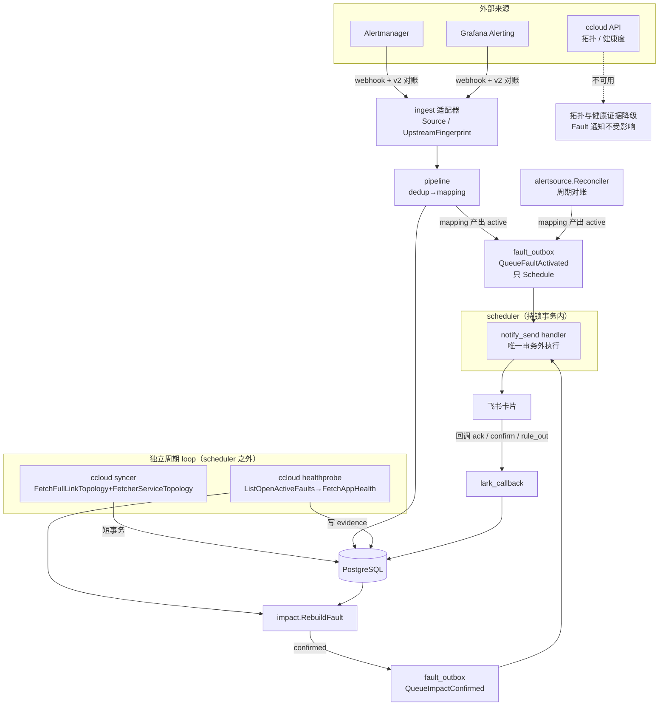

# Design Document — era3-fault-workunit

## Overview

本设计把 ADR-0006 的三根支柱落成五个可独立验收的阶段。**决策内容以 ADR-0006 为权威，本文不重复论证**，只描述实现结构、复用点、数据模型与测试策略。

| 阶段 | 内容 | 版本 |
|---|---|---|
| P0 | 文档固化（ADR / 方向文档 / CLAUDE.md 不变量 22–24） | v0.3 |
| P1 | 身份对齐 + ccloud 拓扑导入 | v0.3 |
| P2 | Fault owner / 认领 / 通知 | v0.3 |
| P3 | Grafana 权威源 | v0.4 |
| P4 | 健康证据 + 自伤消歧 + 影响外播 | v0.4 |
| P5 | 先行指标 + 可靠性 | v0.5 |

依赖关系：`P1 ∥ P2 ∥ P3` 可并行（P2 的 owner 先取 `resource_nodes.owner_team_id`）；`P4` 依赖 `P1 + P2`；`P5` 依赖 `P2`。

## Steering Document Alignment

- **决策权威**：`docs/adr/0006-fault-work-unit-and-platform-topology.md`
- **硬约束**：`CLAUDE.md` 核心架构不变量（本 spec 直接受 3 / 4 / 14 / 15 / 16 / 17 / 20 / 22 / 23 / 24 约束，详见 requirements.md「硬约束」表）
- **方向与证据**：`docs/plans/2026-09-17-era3-direction-analysis.md`
- **领域链路不变**：`Signal → Alert → Fault → Incident → Response → Recovery → Learning`；本 spec 只强化 Fault 段，不改 Incident 门槛

## Code Reuse Analysis

**关键结论：本 spec 大幅复用既有机制，新增代码集中在两个新包与若干扩展点。**

| 复用对象 | 位置 | 复用方式 |
|---|---|---|
| 拓扑快照导入（含 `topology_sync_runs` + 按 source 删旧边） | `internal/store/infrastructure.go` `ImportSnapshot()` | 直接复用；**当前只在测试中被调用，无生产调用方** → ccloud syncer 是首个生产消费者；扩展 `domain.TopologySnapshotEdge` 增加 `ToNodeID` |
| 外部 IO 独立周期 loop 模式 | `internal/alertsource.Reconciler` | 事务外 fetch → 短事务写入；ccloud syncer 与 healthprobe 照此模式 |
| 非 Alert 对象走 `notify_send` 的先例 | `internal/app/incident_outbox.go` | Fault 通知照抄：`QueueIncidentNotification` / `ScheduleRecoveryNudge` / `CancelRecoveryNudge` |
| 通知幂等键与 outbox | `internal/app/outbox.go` `notifySendRefID` | 沿用 `{resourceKey}\|{step}\|{channelKind}\|{target}`（refID 不含 round，round 进 payload） |
| 飞书卡片动作网关 | `internal/api/lark_callback.go` | 新增 `case "impact"`；`handleFaultAction` 补 `ack` 与 actor 校验 |
| 别名与依赖写入 | `store.replaceEntityAliases` / `replaceEntityDependencies` | 受管实体 PUT 的 `aliases` / `dependencies` 复用；缺失=保持不变，显式 `[]`=清空 |
| 变更事件 | `internal/ingest/changeevent.go` + `change_events.resource_ref` | 新增 `ccloud.app_id` 键参与匹配，不新建匹配引擎 |
| 健康度接口鉴权 | `internal/alertsource/client.go` 的 BearerTokenEnv | ccloud client 沿用同一凭据读取口径 |
| 日报与总览 | `internal/ops/report.go` | 追加一节，不新建报表体系 |
| 迁移编号 | `migrations/`（已到 000025） | 本 spec 占用 000026 / 000027 / 000028 |

## Architecture



**关键边界（图中虚线部分）**：ccloud 不可用只降级观测层；Fault 通知、认领、归属链路完全不依赖外部 IO。

## Components and Interfaces

### 新增包 `internal/ccloud/`

```
internal/ccloud/
  client.go      // DTO + Fetch* 方法，只做 HTTP 与反序列化，无 DB 依赖
  importer.go    // 纯映射：DTO → TopologySnapshotEdge / 待对齐项；可单测
  syncer.go      // 周期 loop 装配：事务外 fetch → 短事务 ImportSnapshot
  healthprobe.go // 周期 loop 装配：事务外 FetchAppHealth → 短事务写 evidence
```

```go
// client.go —— 只信 from/to；忽略 key 与 sourceInfo/targetInfo 名字
type TopologyEdge struct {
    From string `json:"from"`   // 调用发起方（consumer）
    To   string `json:"to"`     // 被调方（provider）
    TotalCount int `json:"totalCount"`
}
type TopologyNode struct {
    Key         string   `json:"key"`          // 唯一稳定标识，= metadata.AppID
    ServiceName string   `json:"serviceName"`  // 仅展示；不唯一、可含全角、服务拓扑视图里退化为 key
    ServiceType string   `json:"serviceType"`  // 有前导空格，需 TrimSpace（如 " POSTGRESQL"）
    NodeType    string   `json:"nodeType"`     // 分类判据；EXTERNAL_HTTP_SERVER 节点此处为空
    SLAStandard float64  `json:"slaStandard"`
    Health      *float64 `json:"health"`       // 可空；0.0 是合法测量值，不可与 null 混同
    Metadata    *NodeMetadata `json:"metadata"` // 可能是 null；RELY_NODE/EXTERNAL_HTTP_SERVER 为 null
}
func (c *Client) FetchFullLinkTopology(ctx context.Context, projectID string) (ProjectTopology, error)
func (c *Client) FetchServiceTopology(ctx context.Context, appID string) (ServiceTopology, error)
func (c *Client) FetchAppHealth(ctx context.Context, appIDs []string) ([]AppHealth, error)

// importer.go —— 纯函数，无 IO，便于表驱动单测
type ImportResult struct {
    Edges              []domain.TopologySnapshotEdge
    Unresolved         []UnresolvedIdentity
    DroppedSelfLoop    int
    DroppedExternalHTTP int // 显式计数：一旦非零说明 EXTERNAL_HTTP_SERVER 开始带边，需重新评估
}
func MapTopology(in ProjectTopology, svc []ServiceTopology, resolve AliasResolver) ImportResult
```

**约束**：`importer.go` 不得 import `store`；`client.go` 不得 import `store`；只有 `syncer.go` / `healthprobe.go` 触碰 DB。

**节点分类判据**：`nodeType` 非空时用它，**为空时回落 `serviceType`**（`EXTERNAL_HTTP_SERVER` 节点的
`nodeType` 就是空串，只判 `nodeType` 会漏掉它，也就无法按规则忽略）。比较 `serviceType` 前必须 `TrimSpace`。

**边的方向**：`from` = 调用发起方、`to` = 被调方，与 `dependency_edges`（consumer→provider）**同向，
直接照抄，不做翻转**。判定依据：`CPLM-BOOT-PROD → REDIS` 且 `requestRate≈30.7/s`，只可能是应用调 Redis。

> **全部契约事实、证据与两处待裁决问题见 `internal/ccloud/testdata/README.md`**，fixture 在
> `internal/ccloud/testdata/fulllink_topology.json`（24 节点/77 边）与
> `internal/ccloud/testdata/service_topology_cplm-boot-prod.json`（22 节点/12 边）。
> 其中两处**已知缺口**（入口 APISIX/WAF 故障不向应用传播、`EXTERNAL_HTTP_SERVER` 是否忽略）
> 见该 README §10，属产品裁决项，实施时保持现状并记录。

### 扩展点：`domain.TopologySnapshotEdge`

```go
type TopologySnapshotEdge struct {
    FromNodeRef string
    ToNodeRef   string
    ToNodeID    *uuid.UUID // 新增：预解析的 canonical 实体 id
    Kind        string
    Origin      string     // observed | declared
    Stale       bool
}
```

`ImportSnapshot` 在 `nodeIDs[external_ref]` 查不到时回落 `ToNodeID`，用于表达 **App → canonical `RELY_NODE`** 这类跨源边。

### 扩展点：`internal/app/fault_outbox.go`

```go
func QueueFaultActivated(ctx context.Context, tx pgx.Tx, deps OutboxDeps, f domain.Fault) error
func QueueImpactConfirmed(ctx context.Context, tx pgx.Tx, deps OutboxDeps, f domain.Fault, nodeID uuid.UUID) error
func QueueImpactResolved(ctx context.Context, tx pgx.Tx, deps OutboxDeps, f domain.Fault) error
```

`QueueFaultActivated` 的判定顺序（每一步都必须可单独测试）：

1. **冷却**：同 `correlation_key` 在 `FAULT_NOTIFY_COOLDOWN` 内 resolved → 跳过
2. **拓扑抑制**：`ListDependencyProvidersByNodeID` 上游存在 active 且 `owner_notified_at` 非空 → 不单发，写 fault 时间线说明原因
3. **目标解析**：owner team 的 `team_ops_settings.channels`；为空回落 `FAULT_NOTIFY_FALLBACK_TARGET`
4. **Schedule**：一条 `notify_send`，幂等键 `fault:{id}|activated|{channel}|{target}|{round}`
5. **回写**：`SetOwnerNotified`

> 全程不得出现同步外部 IO（不变量 4）。

**通道能力差异（R5.2 / R5.7）**：`lark`（自建应用，target `chat_id:`/`open_id:`）发交互卡片且按钮可回调；
`lark_webhook`（群自定义机器人）只发纯文本、无回调。落地分两步：

- **P2（本阶段）**：通知走 `lark_webhook`（任务 44），保证"Fault 出现有人被通知到"；认领经 `POST /api/v1/faults/:id/ack` 与 Web 完成。
- **延后**：飞书交互卡片的故障动作（任务 19）与自建应用、卡片回调地址配置（任务 45）一并推进，**阻塞于 uat 尚无公网可回调入口**。
  打通后把团队渠道由 `lark_webhook` 切到 `lark`（纯配置变更），再验证卡片认领。

通知发送两条通道的代码均已存在且按 kind 分发；延后的只是 Fault 卡片的**动作分支与回调处理**（`handleFaultAction` 的 ack）。

**触发入口必须齐全（R5.10）**：`AlertProjector.Project` 在生产代码中有三个调用点，
`QueueFaultActivated` 不能只挂在 pipeline 一处：

| 调用点 | 是否触发 | 理由 |
|---|---|---|
| `internal/pipeline/stage_mapping.go` | 是 | webhook 实时路径 |
| `internal/alertsource/reconciler.go`（两处：`unknown→firing` 恢复、快照缺失） | 是 | Alertmanager 不可用恢复后的 Fault 只经此路径产生，漏触发等同漏报 |
| `internal/api/service_catalog.go` 的 reprocess 端点 | 否 | 人工重新映射属治理操作，不代表新发生的故障 |

实现方式建议：让 `Project` 的返回值（已含 transition 信息，见任务 14）成为统一契约，
由各调用方按上表决定是否调用 `QueueFaultActivated`，避免在 projector 内部耦合通知
（projector 当前零通知依赖，是不变量 9/4 得以成立的基础）。

### 扩展点：`internal/impact/projector.go` `RebuildFault`

在既有 `hasDirect` 分支之后插入 health 分支：

```
最新样本 observed_at >= T + W ?
  ├─ 否 → 保持 potential（"观察中"）
  └─ 是 → health < sla ?
        ├─ 否 → 连续 K 周期达标 ? ruled_out : potential
        └─ 是 → baseline >= sla ?
              ├─ 否 → potential（基线本身破线，不能归因本次）
              └─ 是 → flags.suspected_self_change ?
                    ├─ 是 → potential + flags（交人工）
                    └─ 否 → confirmed
```

**人工裁决优先级**：进入该函数前先读 `fault_impacts.decision`，人工已裁决的节点直接跳过重算（不变量 16）。

### 扩展点：`domain` 权威来源常量集

```go
var AuthoritativeSourceKinds = []string{"alertmanager", "grafana"}
func IsAuthoritativeSourceKind(kind string) bool
```

替换点（全部）：

| 文件 | 现状 |
|---|---|
| `internal/pipeline/stage_dedup.go` | `event.Source == "alertmanager"` |
| `internal/mapping/projector.go` | `isAuthoritativeAlertmanager()` 硬编码 |
| `internal/store/alert_sources.go` | `WHERE i.kind = 'alertmanager'` → `kind IN (...)` |
| `internal/api/config.go` | `req.Kind == "alertmanager"` / `alertmanagerOnly`（3 处） |

`internal/domain/alert.go` 的 `IsAuthoritativeSource()` 已是 `SourceIntegrationID != "" && UpstreamFingerprint != ""`，**不含硬编码，无需改动**。

## Data Models

### 迁移 000026 — Fault 归属、认领与时间线（P2）

```sql
ALTER TABLE faults
  ADD COLUMN owner_team_id     UUID NULL REFERENCES teams(id),
  ADD COLUMN acked_by          UUID NULL,
  ADD COLUMN acked_by_name     TEXT,
  ADD COLUMN acked_at          TIMESTAMPTZ,
  ADD COLUMN owner_notified_at TIMESTAMPTZ;

CREATE INDEX idx_faults_status_owner ON faults(status, owner_team_id);

-- 全库无 fault timeline（已核实：Alert 用 000001 timeline_entries，
-- Incident 用 000013 incident_timeline_entries）
CREATE TABLE fault_timeline_entries (
  id UUID PRIMARY KEY,
  fault_id UUID NOT NULL REFERENCES faults(id) ON DELETE CASCADE,
  actor_id UUID NULL,
  actor_name TEXT NOT NULL,
  action TEXT NOT NULL,
  detail JSONB NOT NULL DEFAULT '{}',
  at TIMESTAMPTZ NOT NULL,
  created_at TIMESTAMPTZ NOT NULL DEFAULT now()
);
```

### 迁移 000027 — ccloud 同步与待对齐身份（P1）

```sql
CREATE TABLE unresolved_identities (
  namespace   TEXT NOT NULL,          -- ccloud.rely_node
  value       TEXT NOT NULL,          -- node.key（不是 host:port！见下）
  host_port   TEXT,                   -- 展示用；可能是 ":0"，也可能是 NULL
  service_type TEXT,                  -- 展示用，已 TrimSpace（REDIS / POSTGRESQL / ORACLE）
  first_seen  TIMESTAMPTZ NOT NULL,
  last_seen   TIMESTAMPTZ NOT NULL,
  sample_app  TEXT,                   -- 样本 appId，便于人判断
  PRIMARY KEY (namespace, value)
);
```

**为什么 `value` 用 `node.key` 而不是 `host:port`**：样例里 Redis 节点的 `serviceName` 是 `":0"`。
若以 `host:port` 作主键值，**所有报 `":0"` 的 Redis 会塌进同一行互相覆盖**，且人看到 `:0` 无从判断是哪个实例。
`node.key`（如 `308e2cc521d64075b181a08e6059cb5b`）是平台侧稳定标识，且该节点是真实边的目标（55264 次调用）。
人工建别名时同时写 `node.key` 与（合法时的）`host:port` 两个 alias，兼顾稳定性与可读性。

`topology_sync_runs` 已在 000012 之前建立（`ImportSnapshot` 已使用），无需新建；仅在需要时补充 `source='ccloud'` 的 kind 约束。

### 迁移 000028 — 健康证据与影响标记（P4）

```sql
CREATE TABLE fault_health_evidence (
  id UUID PRIMARY KEY,
  fault_id UUID NOT NULL REFERENCES faults(id) ON DELETE CASCADE,
  node_id UUID NOT NULL,
  observed_at TIMESTAMPTZ NOT NULL,
  health NUMERIC NOT NULL,
  sla NUMERIC NOT NULL,
  window_seconds INT NOT NULL,
  source TEXT NOT NULL DEFAULT 'ccloud',
  baseline BOOLEAN NOT NULL DEFAULT false
);
CREATE INDEX idx_fhe_fault_observed ON fault_health_evidence(fault_id, observed_at DESC);

ALTER TABLE fault_impacts ADD COLUMN flags JSONB NOT NULL DEFAULT '{}';
-- flags.suspected_self_change = true
```

### 新增配置项

| 配置 | 阶段 | 默认 | 说明 |
|---|---|---|---|
| `CCLOUD_BASE_URL` | P1 | — | 平台地址 |
| `CCLOUD_TOKEN_ENV` | P1 | — | 存放 token 的环境变量名 |
| `CCLOUD_PROJECT_IDS` | P1 | — | 要同步的项目，逗号分隔 |
| `CCLOUD_SYNC_INTERVAL` | P1 | 10m | **0 = 完全关闭** |
| `FAULT_NOTIFY_COOLDOWN` | P2 | 待定 | 同 correlation_key 冷却 |
| `FAULT_NOTIFY_FALLBACK_TARGET` | P2 | — | owner 渠道缺失时的回落目标 |
| `CCLOUD_HEALTH_PROBE_INTERVAL` | P4 | 1m | 0 = 关闭 |
| `CCLOUD_HEALTH_WINDOW` | P4 | **必填** | 未配置则 probe 拒绝启动 |
| `IMPACT_RULED_OUT_STREAK` | P4 | 3 | 连续达标周期数 K |
| `CHANGE_SUSPECT_WINDOW` | P4 | 30m | 变更消歧回看窗口 |

## Error Handling

| 场景 | 行为 |
|---|---|
| ccloud 接口超时 / 5xx | 单轮失败写入 `topology_sync_runs` 并退避；不 fail fast，不阻塞启动；既有 observed 边按 stale 规则过期 |
| `CCLOUD_HEALTH_WINDOW` 未配置但 probe 开启 | **启动期 fail fast** 并给出明确错误（不允许猜默认值） |
| 未对齐 `RELY_NODE` | 写 `unresolved_identities`，**绝不建实体**、绝不猜归属 |
| 重复 ack / 已 ack 再 ack | 短路 200 返回当前状态，不 409、不重写时间线 |
| 通知发送失败 | 沿用 `notify_send` 的 claimed + 租约 + fencing 机制，最终失败发一次元告警到 fallback |
| 飞书回调 actor 缺失 | admin 动作拒绝并落审计；ack 动作按登录态处理 |
| 人工裁决与自动重算冲突 | 人工优先，自动重算跳过已裁决节点 |
| scheduler / pipeline 停摆 | `/readyz` 返回 503，`/healthz` 保持 200 |

## Testing Strategy

| 层次 | 内容 |
|---|---|
| 单测（纯函数） | `importer.MapTopology` 表驱动：方向取自 from/to、自环丢弃、`totalCount=0` → stale、`:0` → unresolved、重放幂等；`domain.AckFault` 幂等矩阵；`AuthoritativeSourceKinds` 判定；`RebuildFault` health 判定矩阵（窗口未到 / 基线低于 SLA / 有变更 / 连续达标 / 人工已裁决） |
| store 集成测（`//go:build integration`） | `ImportSnapshot` 按 source 隔离：ccloud 边替换不动 `entity_registry` 边；`fault_timeline_entries` 写入顺序；`unresolved_identities` UPSERT 不重复插入 |
| E2E（`test/e2e` 真实 PG） | ① P2：Alertmanager webhook → Fault active → 恰好一条 `notify_send` → 卡片 ack 回调 → acked；重复 ack 200 短路；冷却内不重发；上游已通知时下游不发。② P3：`grafana_authority_test`（webhook firing/resolved、对账 absence → stale 不 resolved、Fault 映射生效）。③ P4：fake ccloud health server → confirmed → 影响卡片 → rule_out 回调后重算不覆盖 |
| 前端 | `cd web && npm run build && npx oxlint` |

**每阶段统一验证命令**：

```bash
go build ./... && go vet ./... && go vet -tags=integration ./...
go test -tags=integration ./... -race -count=1
cd web && npm run build && npx oxlint
cd test/e2e && docker compose up -d   # 固定 Compose project/端口，任何时刻只能跑一轮
```

## 需求覆盖自查

| 阶段 | 覆盖要求 |
|---|---|
| P1 | R1、R2（R1.5 的指标消费在 P5） |
| P2 | R3、R4、R5 |
| P3 | R6 |
| P4 | R7、R8、R9 |
| P5 | R10（R10.5 的探针切换为人工动作） |

**未覆盖（有意排除）**：E1 映射治理体验、E3 飞书 Incident 指挥闭环 —— 见 `docs/plans/2026-09-17-era3-direction-analysis.md` §8。
