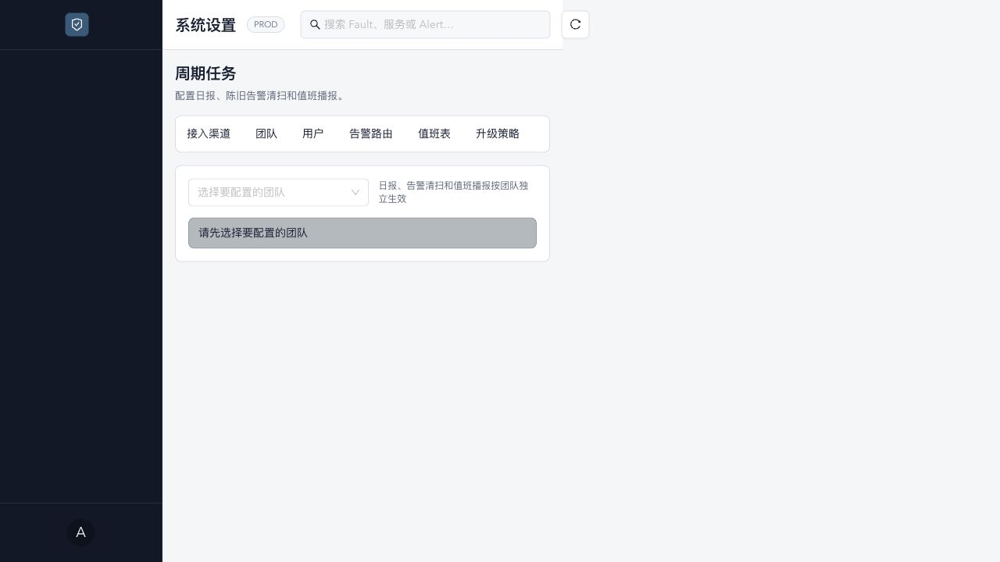
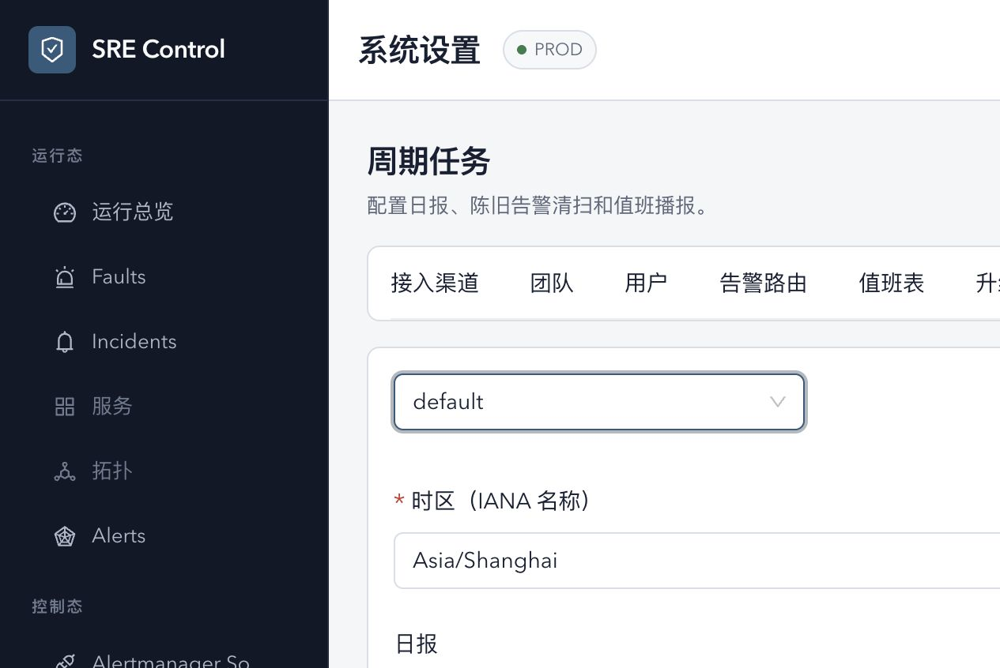
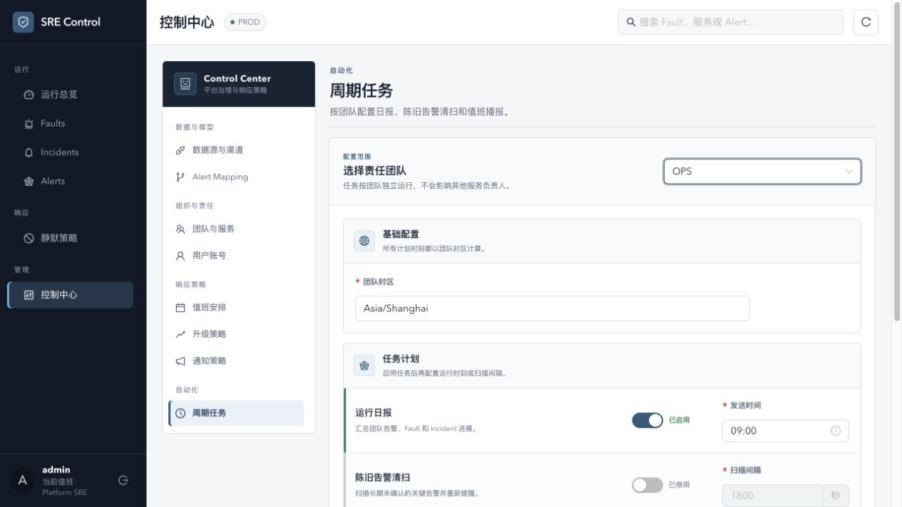
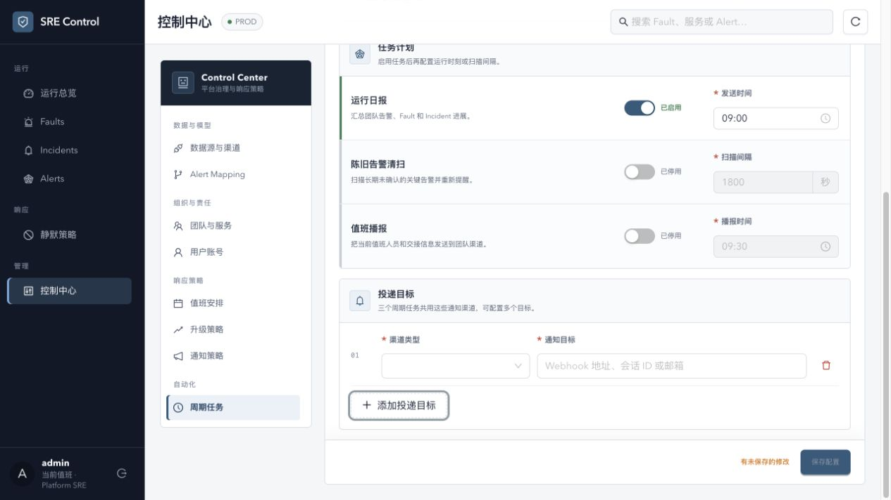
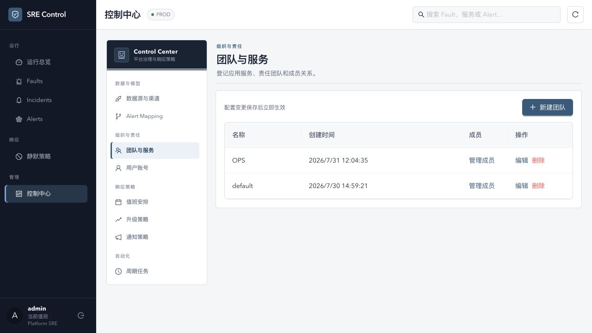

# SRE Control 导航与周期任务设置审计

## 审计范围

- 产品表面：登录后的全局侧栏、控制态入口、`/settings/ops-settings` 周期任务页面。
- 用户目标：SRE 在保持运行上下文的同时，快速找到并修改某个团队的自动化任务配置。
- 辅助功能目标：导航层级可理解、键盘可操作、表单控件有唯一名称、窄屏不丢失入口。

## 证据步骤

### 1. 周期任务空状态 — 健康度：较差

- 优点：页面标题和团队选择前置，用户能理解配置以团队为范围。
- UX 风险：全局侧栏已经列出多项控制态资源，页面内又平铺八个设置 Tab；两个层级相互重复，用户难以判断“团队与服务登记”为何会高亮到“周期任务”。
- UX 风险：未完成的“服务、拓扑、Entity 治理”仍占据一级导航，增加视觉噪声却无法完成任务。
- 无障碍风险：页面 DOM 出现嵌套 `main`；设置 Tab 在中等宽度开始截断，依赖水平滚动发现后续入口。

### 2. 选择团队后的编辑表单 — 健康度：较差

- 优点：三个任务共用渠道的事实被写明；时间和间隔使用了匹配的数据控件。
- UX 风险：关闭状态的任务仍展示为可编辑时间/间隔，状态和可操作范围矛盾。
- UX 风险：所有字段纵向平铺，没有区分“团队范围、基础时区、任务开关、投递目标”；宽屏空间大量浪费，长表单却缺少局部摘要。
- UX 风险：切换团队没有未保存变更保护，配置可能被无提示覆盖。
- 无障碍风险：三个 Switch 在可访问树里都只叫 `switch`；两个 TimePicker 都叫 `Select time`，语音或键盘用户无法区分。
- 无障碍风险：Ant Design 虚拟化 Select 的可见 option 无法通过 role 点击，浏览器 E2E 只能退回键盘导航，而且焦点初始项容易造成误选。

## 结构性问题

1. 全局导航混合了 SRE 日常任务、未来占位能力和后台资源配置。
2. 控制态资源既在侧栏出现，又在横向 Tab 重复，当前选中态不能准确表达页面位置。
3. 设置页使用宽屏横向导航，但资源数量已经超过稳定承载范围。
4. 表单只反映数据库字段，没有把“是否启用、何时运行、发到哪里”组织成任务对象。

## 推荐方向

采用“任务侧栏 + 控制中心”的两层模型：

- 全局侧栏仅保留运行总览、Faults、Incidents、Alerts、静默策略、控制中心；隐藏尚不可用的占位入口。
- 控制中心内部使用分组垂直导航：数据与模型、组织与责任、响应策略、自动化。
- 周期任务页面以团队为上下文，把每个任务呈现为独立状态行；关闭时禁用其参数，保存前保护未提交修改。
- 中等屏幕把控制中心垂直导航切换为单一 Select，不再挤压横向 Tab。

## 实施后验证

### 3. 控制中心与任务计划 — 健康度：良好

- 全局侧栏只保留六个一级任务，控制中心成为唯一管理入口。
- 设置资源按领域垂直分组，当前页面在全局与局部各有一个明确选中态。
- 任务参数与开关在同一行呈现；关闭状态参数不可编辑，开启日报后发送时间立即可用。
- 三个 Switch、两个 TimePicker 和扫描间隔均有唯一可访问名称。

### 4. 投递目标与保存反馈 — 健康度：良好

- 添加目标后出现编号、渠道类型、目标和删除动作，空状态不再与实际编辑状态并存。
- 底部保存栏持续显示“有未保存的修改”，保存按钮只在发生变更后启用。
- 带未保存修改切换团队时会出现“继续编辑 / 放弃并切换”确认。

### 5. 团队与服务子页面 — 健康度：良好

- 同一控制中心框架能承载表格型资源页，不再重复横向 Tab。
- 页面标题、说明、主操作和数据表形成稳定阅读顺序。
- 当前“团队与服务”同时在局部导航和内容标题中对应，不再出现周期任务却高亮团队入口的错位。

## 证据边界

- 截图可以确认层级、密度、截断和可见控件问题，不能单独证明完整 WCAG 合规。
- 键盘选择和可访问名称已通过当前浏览器 DOM/交互复核；屏幕阅读器朗读、200% 缩放和多语言仍需在实现后专项验证。
