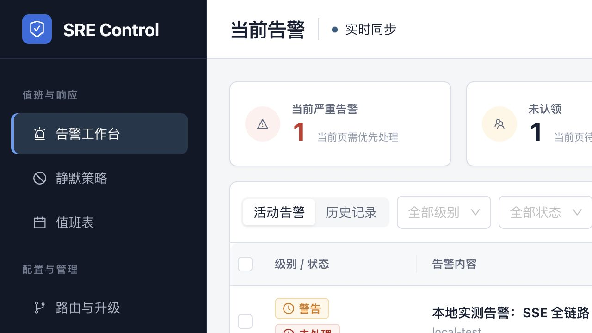
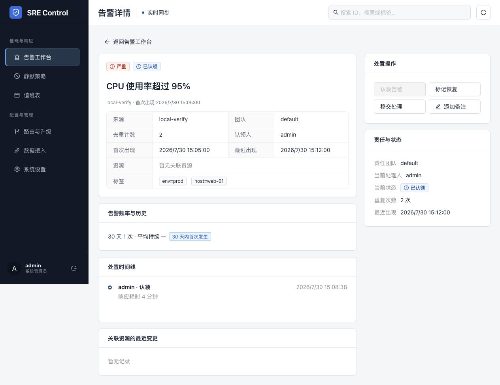
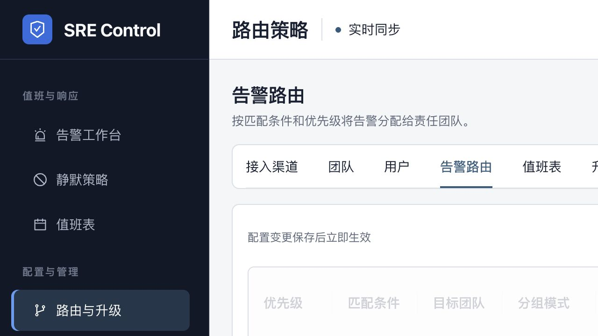
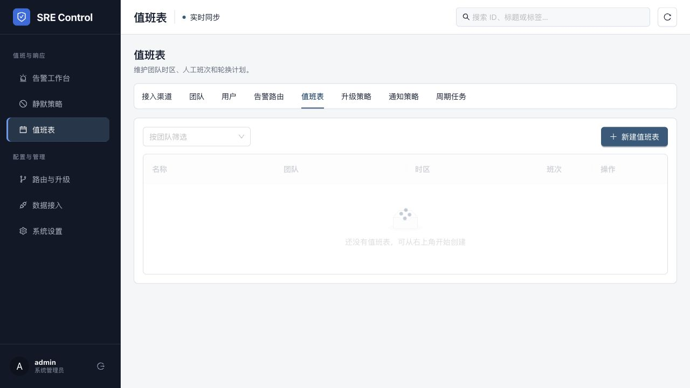

# Alert System 对标设计审计与优化建议

日期：2026-08-01

## 结论

当前版本已经从“默认 Ant Design 后台”进化成一个视觉稳定、层级明确的告警工作台；与参考集里的 PagerTree 旧界面相比，当前告警列表与详情的视觉质量更好。下一阶段不应继续以换颜色、加卡片为主，而应把产品从“告警与配置后台”推进为“事故响应工作台”。

最值得吸收的四类机制：

1. PagerTree：在同一上下文展示当前值班、响应耗时、通知送达、移交和升级策略。
2. AlertOps：把排班与升级策略画成时间/流程模型，减少配置理解成本。
3. PagerDuty：以 Incident、Service、Automation、Status Page 组织产品，而不是只围绕 Alert。
4. Squadcast：把降噪、Runbook、复盘、服务健康和可靠性分析串成持续学习闭环。

## 审计范围与用户目标

用户目标是快速回答四个问题：

- 现在最应该处理什么？
- 谁正在负责，多久必须响应？
- 系统已经通知了谁，是否送达？
- 应该采取什么动作，处理完成后能沉淀什么？

当前审计覆盖：告警工作台、告警详情、路由配置、值班表，以及 `examples/` 中的 PagerTree、AlertOps、PagerDuty、Squadcast 参考截图。

## 当前流程截图与健康度

### Step 1：告警工作台 — 健康，但缺少响应上下文

优点：状态与严重度清楚，活动/历史视图明确，筛选和批量动作容易发现。

问题：摘要只描述告警数量，没有回答“当前谁值班、最老未响应多久、下一次升级何时发生”；在 1280px 宽度下，页面右侧内容被截断，说明表格和摘要卡尚未形成可靠的响应式降级策略。

### Step 2：告警详情 — 良好，是最适合继续增强的页面

优点：责任、状态、频率、时间线、最近变更与处置动作已经构成完整骨架；右侧处置区让主任务始终可见。

问题：缺少通知送达证据、下一次升级倒计时、运行手册入口、外部协作状态；“处置时间线”只呈现人工动作，系统自动路由、通知、重试、升级等关键事件不可见。

### Step 3：路由配置 — 能用，但心智成本和变更风险较高

优点：配置对象集中，空状态有创建入口，文案说明保存后立即生效。

问题：八个横向标签在 1280px 下溢出；路由以字段表格表达，用户无法直观看到“这条告警会匹配哪条规则、分到谁、何时升级”；立即生效却没有模拟、差异预览、审计与回滚提示。

### Step 4：值班表 — 结构清楚，但仍是资源列表

优点：筛选、新建入口和空状态都清楚。

问题：没有日/周/月时间视图、当前值班人、排班缺口、覆盖冲突、临时替班和升级链联动；值班表与团队、升级策略被拆到不同标签，值班人员需要跨页面理解完整响应链。

## 可迁移的参考机制

### 1. 团队响应首页，而不只是团队 CRUD

PagerTree 的团队详情把团队成员、当前值班表、日历和升级策略放在同一页：

建议为 alert-system 增加“团队响应页”：当前值班人、下一班次、未认领 critical、排班缺口、绑定路由、升级策略和通知健康度都围绕团队呈现。现有团队 CRUD 保留为编辑入口，不再承担团队主视图。

### 2. 公开通知送达链路

PagerTree 告警详情会列出 recipient、channel、status、created_at，并区分 delivered/failed：

alert-system 后端已经有 `notification_log`、重试次数、错误信息和定时器状态，但前端没有展示。建议在告警详情增加“通知与升级”时间轴：

- 目标人员/群组与渠道；
- 计划时间、实际发送时间和下一次升级倒计时；
- sent/failed/pending、尝试次数和安全处理后的错误摘要；
- 手动重试、切换渠道、跳过本级与升级到下一层。

### 3. 把升级配置画成流程，而不是 JSON/表格

AlertOps 用纵向时间线表达每一层等待时间、接收人和渠道：

建议新增可视化策略预览：`触发 → 等待 0 分钟 → 当班人 → 等待 5 分钟 → 团队负责人 → 等待 10 分钟 → 广播群`。编辑仍可用现有表单，右侧同步显示流程预览；保存前允许粘贴一组 labels 做“路由试算”。

### 4. 用时间视图管理排班

AlertOps 的排班按周展示不同轮班层和主/备责任人：

建议值班页默认展示本周时间轴，并明确：当前当班、备班、交接点、未覆盖时段、冲突班次和临时替班。列表模式作为管理视图保留，而不是唯一视图。

### 5. 从 Alert 上升到 Incident 与 Service

PagerDuty/Squadcast 的产品结构共同强调 Incident、Service Health、Status Page、Runbook、Postmortem 和 Reliability Insights。当前 alert-system 已有 fingerprint、group、resource_ref、change_events、storm/flapping 和 annotations，这些足以形成下一层领域模型：

- Alert：原始信号，数量多、生命周期短；
- Incident：需要人协作解决的事件，可聚合多个 Alert；
- Service：稳定责任边界，关联团队、值班、Runbook、SLO 和状态；
- Response：围绕 Incident 的认领、角色、行动、通知、沟通和复盘。

不建议直接把现有 Alert 改名为 Incident。应新增 Incident 聚合层，保留 Alert 作为证据和触发源。

## 三条产品方向

### A. Response-first 响应工作台（推荐）

在现有架构上补齐响应上下文：当前值班、SLA/升级倒计时、通知送达、Runbook、协作时间线、团队响应页。改动可渐进交付，能立即降低漏接和排障切换成本。

### B. Service-first 服务可靠性平台

新增服务目录、服务健康、SLO/Error Budget、依赖关系和状态页。长期价值高，但需要新的领域模型、数据接入和组织治理，适合作为第二阶段。

### C. AI/Automation-first 自动化平台

激活现有 `annotations`、`action_rules`、`action_runs`：自动摘要、关联建议、根因假设、Runbook 执行。潜力大，但如果缺少 Incident/Service 上下文，AI 只能在单条告警上生成漂亮但低可信的文字，不应先于方向 A。

推荐顺序：A → B → C。AI 应嵌入响应流程，先做有证据、可接受/驳回的建议，不直接自动关闭告警。

## 优先级建议

### P0：先把现有能力变得可信、可读、可操作

1. 告警详情增加通知送达与升级时间线，复用现有 `notification_log`。
2. 工作台增加“当前值班、最老未认领、即将升级、发送失败”四个响应指标。
3. 修复 1280px 下表格与设置标签溢出：折叠侧栏、配置二级导航、关键列冻结、次要列按需展开。
4. 路由/升级策略增加 labels 试算、影响范围预览和保存前 diff。
5. 集成页采用“模板卡片 + 配置向导 + 发送测试 + 最近一次健康检查”，避免只有 CRUD 表格。

### P1：建立 Incident 响应闭环

1. 新增 Incident 聚合层与事件指挥角色：负责人、沟通人、记录人。
2. 增加 Runbook 链接/步骤、协作备注、关键动作清单和恢复条件。
3. 增加内部 Broadcast 与外部 Status Update，统一记录到 Incident 时间线。
4. 团队详情升级为响应首页，整合值班、升级、路由和告警负载。
5. 建立 MTTA、MTTR、未认领时长、通知成功率、Top noisy fingerprints、风暴/抖动等报告。

### P2：服务可靠性与可信 AI

1. Service Catalog：服务、责任团队、资源、依赖、Runbook、SLO。
2. 服务健康与状态页；Incident 对服务状态产生可审计影响。
3. 激活 annotations：摘要、重复/关联建议、根因假设，必须展示证据和来源。
4. 激活 action rules/runs：只读动作优先；变更动作必须人工确认、冷却、审计和回滚。

## 可访问性与响应式风险

- 当前列表和设置页在 1280px 截图中出现横向内容被裁切；需要在 1024/1280/1440 三档验证重排，而不只是允许横向滚动。
- 状态标签字体较小、背景较淡；需实测文本和边框对比度，不能仅凭截图断言满足 WCAG。
- 表格行点击可进入详情，但视觉上缺少明确链接或箭头提示；键盘用户可能不知道整行可操作。
- “实时同步”只用一个圆点传达状态；应有可读文本、最后同步时间和断线/重连反馈。
- 空状态应把主操作放在空状态内部，避免主要 CTA 位于宽表格的右上角而在窄屏不可见。

## 证据限制

参考集部分截图是营销页或旧产品界面，只能用于提取产品能力与信息架构，不能证明真实交互质量。当前页面的视觉、DOM 和主要导航已检查；键盘全流程、屏幕阅读器、缩放 200%、移动端和高延迟状态仍需单独验证。
