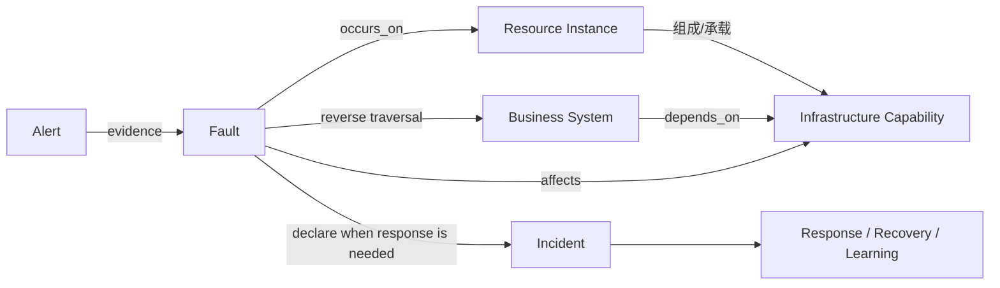

# Infrastructure-first Fault / Incident 产品与领域设计

## 1. 目标与第一性原则

产品服务于维护共享基础设施的平台型 SRE。首页首先要回答：

1. 我负责的基础设施能力是否健康，监控和拓扑覆盖是否可信？
2. 当前存在哪些技术故障，哪些告警是根因候选、症状或噪声？
3. 哪些业务系统可能受影响，传播路径和爆炸半径是什么？
4. 哪些 Fault 已经需要升级为 Incident，谁负责协调响应？

配置后台仍然存在，但只是控制平面。默认工作面不是告警 CRUD，也不是只有 Incident 列表。

## 2. 概念模型

依赖关系是有方向、多对多的图，而不是目录树。典型边包括：

- `contains`：基础设施能力包含资源实例。
- `runs_on`：应用或组件运行于集群、主机或数据库能力。
- `depends_on`：业务系统依赖基础设施能力或另一业务系统。
- `connects_to`：服务访问数据库、消息队列或外部接口。
- `replicates_to`：主备、复制或灾备关系。

遍历爆炸半径时只沿经过批准的反向依赖边传播，并限制环境、最大深度和边类型，防止循环依赖与无限扩散。

## 3. 领域对象

### ResourceNode

- 外部标识、类型、名称、环境、区域、所有者团队。
- 来源、外部版本、最后同步时间、数据新鲜度。
- 类型至少覆盖资源实例、基础设施能力、业务系统。

### DependencyEdge

- `from_node_id`、`to_node_id`、关系类型、来源、有效期和最后同步时间。
- 方向统一表达“消费者依赖提供者”；爆炸半径从提供者反向寻找消费者。

### Fault

- 状态：`candidate → active → mitigated → resolved`，或 `dismissed`。
- 发生对象、技术摘要、严重度、首次/最近观测时间、当前根因假设。
- 影响计算结果必须带拓扑快照时间与解释，不覆盖人工确认结果。

### FaultAlertLink

- 角色：`trigger`、`cause_candidate`、`symptom`、`supporting`、`excluded`。
- 来源：`rule`、`topology`、`human`、`ai_suggestion`。
- 保存置信度、规则/路径依据、创建者与时间；人工裁决优先级最高。

### Incident

- 围绕一个或多个 Fault 创建。
- 状态：`declared → responding → monitoring → resolved → postmortem`。
- 保存业务影响、Incident Commander、响应角色、任务、通信与时间线。

## 4. 告警到故障的数据流

1. 既有管道继续完成归一化、去重、路由、分组、静默和通知。
2. 告警提交后，异步关联器根据 `resource_ref` 解析 ResourceNode；解析失败时保留“未映射证据”，不丢弃告警。
3. 确定性规则先检查同资源、同基础设施能力、时间窗口和相同故障签名。
4. 拓扑规则检查上下游传播路径和时间顺序，生成可解释的关联建议。
5. 高置信确定性规则可创建 `candidate Fault`，但自动合并必须可撤销；中低置信建议等待人工确认。
6. SRE 可合并/拆分 Fault、改变告警角色、排除无关证据、确认根因。
7. Fault 的反向依赖遍历产生受影响业务候选和爆炸半径；当达到业务影响、跨团队或升级阈值时创建 Incident。

禁止仅依据“时间接近”合并告警。AI 只能在异步旁路提出建议，不能直接改写 Fault 或 Incident。

## 5. 默认工作台信息架构

### 运行总览

- 责任范围：Kubernetes、数据库、网络、存储、消息队列等基础设施能力及健康状态。
- 数据可信度：监控覆盖、未映射资源、拓扑最后同步时间和过期边数量。
- 当前 Fault：按技术严重度、持续时间、受影响业务数和是否有人负责排序。
- 爆炸半径：选中 Fault 后展示受影响业务、传播路径、负责人和置信度。
- 响应判断：继续观察、确认 Fault、排除证据、升级为 Incident。

不默认展示全量拓扑毛线球。首屏使用“基础设施能力分组 + Fault 队列 + 聚焦影响路径”，完整依赖图只在选中对象后按需展开。

### Fault 工作区

- 左侧：Fault 和待关联告警队列。
- 中间：技术事实、证据角色、资源上下文、变更与时间线。
- 右侧：爆炸半径、受影响业务、负责人、Runbook 和升级 Incident 操作。

### Incident Room

- 只承接已宣布 Incident 的协作响应。
- 展示业务影响、Commander、响应角色、任务、通信、Fault 根因链和恢复条件。

Incident Room 不重复 Fault 调查。它以“把已确认的技术与业务影响转化为可协作的响应”为目标，页面分为三层：

1. 事故指挥条：Incident ID、严重等级、当前阶段、持续时间、业务影响、指挥官、下次状态通报倒计时、关联 Fault 入口和拓扑快照新鲜度。
2. 统一响应时间线：只收录会改变响应判断的事实、假设、决策、自动化执行、对外通报和恢复信号；原始告警流水仍留在 Fault/告警证据层。
3. 固定指挥栏：响应角色与在线状态、任务及责任人、受影响业务确认、恢复判据，以及分派任务、运行 Runbook、发布飞书通报、标记缓解和进入恢复监控等高频操作。

状态转换必须有明确门槛：只有影响不再扩大才能标记“已缓解”；只有恢复判据达标且经过观察窗口才能进入“已恢复”；任何阶段都能返回关联 Fault 查看技术证据，但 Incident 中的人工决策不会被后续自动关联覆盖。

### 控制中心

- CMDB/资源目录同步、关系映射、关联规则、告警路由、值班、升级和通知策略。

## 6. 存储与架构建议

第一阶段继续使用 PostgreSQL：

- `resource_nodes`：外部 CMDB 实体的只读投影。
- `dependency_edges`：邻接表；唯一键包含来源实体、目标实体、关系类型和来源。
- `topology_sync_runs`：同步结果、版本、新鲜度和错误。
- `faults`、`fault_alert_links`、`fault_impacts`。
- `incidents`、`incident_fault_links`，后续再补响应角色和任务。

爆炸半径查询可先用受限深度的递归 CTE；若真实规模和查询延迟证明 PostgreSQL 不足，再单独裁决图存储。

## 7. 失败模式与降级

- CMDB 不可用：告警管道照常运行，展示最后成功快照和过期提示。
- 资源无法映射：进入未映射证据队列，不猜测业务影响。
- 拓扑循环：遍历使用 visited set、深度上限和环境边界。
- 错误关联：所有自动关联可撤销，人工排除形成后续规则测试样本。
- 爆炸半径不完整：明确标为“基于拓扑快照的候选影响”，显示快照时间与置信度。
- 外部输入不可信：CMDB 和变更 webhook 仍需鉴权、schema 校验、大小限制和敏感字段脱敏。

## 8. 分阶段交付

### Phase 1：可解释的最小闭环

- 资源/能力/业务系统只读投影与依赖边同步。
- 手工创建/确认 Fault，告警证据角色与合并拆分。
- 受限拓扑遍历和爆炸半径候选。
- Fault 升级为 Incident，复用现有通知、时间线和值班能力。

### Phase 2：确定性自动关联

- 同资源、同能力、时间窗和拓扑传播规则。
- 关联规则回放、命中解释、误关联撤销和质量指标。

### Phase 3：响应协作与学习

- Incident Commander、角色、任务、状态广播、Postmortem。
- AI 摘要与根因建议仅作为异步、可解释、可拒绝的增强层。

## 9. 验收场景

1. 共享 MySQL 主库异常产生 1 条根因候选和多条业务症状告警，形成一个 Fault。
2. 系统根据依赖图列出支付、订单两个受影响业务，并显示传播路径与拓扑快照时间。
3. SRE 排除一个无关告警、拆分错误 Fault，审计记录完整。
4. Fault 未产生显著业务影响时不自动创建 Incident。
5. SRE 宣布 Incident 后，复用值班、飞书通知、响应时间线和 Runbook。
6. CMDB 不可用或拓扑过期时，告警处理与通知不受影响，UI 明确降级状态。
