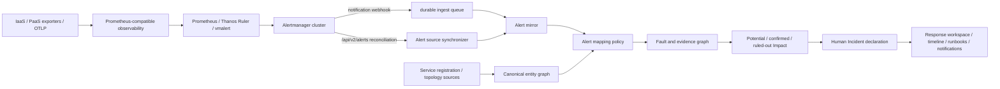

# Alertmanager 权威的通用 SRE Control 设计

## 1. 状态与目标

**状态：已确认**
**日期：2026-08-02**

本设计把 alert-system 收敛为一个 Incident-first 的 SRE Control：它不存储原始指标、日志和链路，也不在第一阶段实现 Prometheus Rule/Thanos Ruler/vmalert 工作站；它从 Alertmanager 获取权威 Alert 状态，将 Alert 映射到通用实体，形成可解释的 Fault、Impact 和 Incident，并为 SRE 提供响应与协作工作台。

核心链路为：

```text
Telemetry → Rule Evaluator → Alertmanager → Alert mirror
                                      → Entity/Fault/Impact → Incident/Response
```

本设计延续 ADR-0001 的 `Signal → Alert → Fault → Incident → Response → Recovery → Learning`，保留 ADR-0002 的 E2B 黄金场景，但取代以下默认假设：

- 不再以 E2B、CCH 等业务专用 Connector/System Pack 作为通用接入前提；
- 不再要求每套业务先建立一个 `ManagedSystem` 拓扑根；
- 不在第一阶段复刻 Alertmanager 的路由、分组、静默和抑制语义；
- 不在第一阶段构建完整的冗余、容量或业务旅程推理引擎。

## 2. 第一性约束

### 2.1 系统事实

- IaaS、PaaS 和应用服务使用不同采集协议，但最终都可由 Prometheus 规则形成 Alert，并由 Alertmanager 管理生命周期。
- 同一个基础设施 Fault 可能影响多个应用服务，爆炸半径取决于依赖关系、冗余和实时业务证据。
- Alert 是观测系统的判定；Fault 是 SRE Control 对技术故障的解释；Incident 是组织为处理影响而建立的响应容器，三者不能混为一个状态机。
- 单靠依赖图只能推导“可能受影响”，不能证明用户已经受影响。
- 新业务接入的稳定公共部分是服务、团队、实体、关系、标签与映射，不是每个业务的专用代码分支。

### 2.2 第一阶段边界

第一阶段负责：

- 接入一个或多个逻辑 Alertmanager 集群；
- 可靠镜像 Alert 状态与 Alertmanager 抑制状态；
- 登记应用服务及负责团队；
- 维护最小分层实体图及外部别名；
- 通过显式策略把 Alert 映射成 Fault 证据；
- 计算 potential Impact，并用业务证据或人工判断确认/排除；
- 支持多 Fault Incident、响应协作、审计和通知。

第一阶段不负责：

- 原始 metrics/logs/traces 的长期存储和查询；
- PromQL 规则编辑、评估和调度；
- 替代 Alertmanager 的通知策略、分组、静默和抑制；
- 自动推断主备、ISR、ReplicaSet、容量余量等全部可用性语义；
- 从遥测自动创建团队或认定服务归属；
- 由 AI 自动宣布 Incident、裁定根因或执行高风险处置。

## 3. 高层架构



| 组件 | 权威数据 | SRE Control 中的职责 |
|---|---|---|
| Prometheus/Thanos/VictoriaMetrics/OTel 后端 | 原始遥测与查询 | 仅保存链接、查询表达式、时间范围等证据引用 |
| Rule evaluator | 规则定义与评估 | 第一阶段只消费结果，不编辑或执行规则 |
| Alertmanager | Alert firing/resolved、silenced/inhibited | 唯一 Alert 权威；SRE Control 建立本地只读镜像 |
| SRE Control | Entity、Fault、Impact、Incident、响应记录 | 相关、解释、协作、审计与恢复管理 |

SRE Control 不位于 Alertmanager 的关键通知路径上。它故障时不能阻断 Alertmanager 向现有 Pager、飞书或其他通知渠道发送消息。

## 4. Alert Source 与可靠同步

### 4.1 逻辑数据源

一个 HA Alertmanager 集群在 SRE Control 中登记为一个 `AlertSource`，多个副本共享同一个逻辑 `source_id`，避免把同一 Alert 复制成多份。

`AlertSource` 至少包含：

- 名称、环境和 API endpoint；
- webhook 身份与只读 API 凭据的 secret reference；
- 同步周期、stale 阈值、缺失确认次数；
- 最近成功 webhook/API 时间、最近错误和当前健康状态。

默认参数：

- API 对账周期：30 秒；
- 数据源 stale 阈值：2 分钟；
- 连续缺失确认：3 次成功快照。

### 4.2 两条互补链路

1. **Webhook 快路径**：通知 webhook 收到 payload 后先验证、限流并写入持久队列，再异步归一化；目标是低延迟可见。
2. **API 对账慢路径**：周期读取 `/api/v2/alerts` 的完整当前视图，修复 webhook 因分组、repeat interval、路由、silence 或 inhibit 造成的缺口。

Event Recorder 可作为以后获取更完整事件流的增强能力，但不是第一阶段的正确性依赖。

### 4.3 幂等与乱序

Alert occurrence 的稳定身份为：

```text
source_id + upstream_fingerprint + starts_at
```

相同 occurrence 的重复 webhook/API 结果必须幂等。更新时比较上游时间和本地版本，旧事件不得覆盖新状态。

对账规则：

- Alert 首次从一次成功快照中缺失时，将 `source_state` 置为 `unknown`，保留现场；
- 连续达到缺失确认次数且超过宽限期后，以 `source_reconciled` 原因关闭；
- API 请求失败只把 `AlertSource` 标记为 stale，不修改任何 Alert 生命周期；
- 数据源恢复后，以下一个成功完整快照继续收敛。

## 5. Alert 三轴状态模型

Alert 不再用单一 `status` 混合来源事实和本地操作：

| 轴 | 值 | 写入者 |
|---|---|---|
| `source_state` | `firing` / `resolved` / `unknown` | 仅 Alertmanager 同步器 |
| `response_state` | `unacknowledged` / `acknowledged` | SRE Control 用户/API |
| `suppression_state` | `none` / `silenced` / `inhibited` | 仅 Alertmanager 同步器 |

约束：

- Ack、Handoff、Note 是本地响应行为，不改变 Alertmanager 的 firing/resolved 事实；
- Alertmanager 来源禁用本地 Manual Resolve；
- silenced/inhibited Alert 仍然是有效 Fault 证据，只是不应在 SRE Control 中被重复通知；
- 来源 stale 或对账不确定时显示 `unknown`，不得伪造 resolved。

## 6. 通用实体与服务登记

### 6.1 最小实体图

统一使用 `Entity`、`EntityAlias` 和 `EntityRelation`，不为物理机、Kubernetes、数据库或业务分别创建不相容的身份模型。

`Entity`：

- `entity_key`：SRE Control 内全局稳定身份；
- `layer`：`infrastructure` / `platform` / `application`；
- `kind`：受控但可扩展的字符串，如 `host`、`vm`、`k8s_node`、`database`、`kafka_cluster`、`service`；
- 名称、环境、生命周期、管理状态和元数据。

`EntityAlias` 把 Prometheus label、Kubernetes UID、CMDB ID、OTel resource attribute 等外部身份映射到 canonical entity。外部引用不是实体主键；同一 alias 指向多个实体时进入隔离队列，不猜测归属。

`EntityRelation` 第一阶段只支持：

- `runs_on`；
- `depends_on`；
- `part_of`。

边统一从**消费者/从属方**指向**提供者/宿主方**。从发生 Fault 的实体沿反向边遍历即可找到潜在消费者。遍历必须限制深度、节点数并检测环。

### 6.2 服务与团队是显式权威

应用服务及负责团队通过 `ServiceRegistration` 显式登记，至少包含：

- canonical service entity；
- environment；
- owning team；
- tier/criticality；
- 可选的 SLO、synthetic、dashboard、runbook 引用。

遥测发现可以创建 `unmanaged` 占位实体并进入治理队列，但不能自动创建团队或分配 ownership。第一阶段爆炸半径的业务终点是“应用服务及其负责团队”，不扩展到业务能力、用户旅程或收入模型。

## 7. 从 Alert 到 Fault

### 7.1 显式映射契约

只有满足以下任一条件的 Alert 才能参与自动 Fault 建模：

1. 匹配已发布的 `AlertMappingPolicy`；
2. 携带受信来源签发的标准标签：
   - `sre.entity.key`
   - `sre.fault.kind`
   - `sre.evidence.role`

未映射 Alert 仍保留在 Alert 列表，但进入治理队列，不使用 `alertname` 字符串猜测实体或故障类型。

示例策略：

```yaml
name: kubernetes-node-unavailable
source: prod-alertmanager
match:
  alertname: KubeNodeNotReady
entity:
  alias_namespace: prometheus.kubernetes.node
  alias_label: node
fault:
  kind: compute_node_unavailable
  evidence_role: direct
  correlation_labels: [cluster, node]
```

策略发布必须经过校验、样本预览、版本化和可回滚。通用 correlation key 由 canonical entity、fault kind 和策略声明的 correlation labels 组成，不包含 E2B/CCH 等业务前缀。

### 7.2 Fault 证据角色

证据角色至少包括：

- `direct`：可直接证明实体处于该故障；
- `supporting`：支持故障判断；
- `cause_candidate`：可能原因；
- `trigger`：触发条件；
- `amplifier`：放大因素；
- `symptom`：下游症状；
- `excluded`：经人工或证据排除。

`direct` firing Alert 可以创建或激活 Fault。只有 supporting/cause_candidate/trigger/amplifier/symptom 时，系统至多建立 candidate Fault，不把相关性当成事实。silenced/inhibited 不降低证据有效性。

## 8. Impact 与 Incident

### 8.1 Impact 三态

每个 Fault 到应用服务的影响为：

| 状态 | 含义 | 典型来源 |
|---|---|---|
| `potential` | 依赖图可达，但尚无业务影响证据 | 反向拓扑遍历 |
| `confirmed` | 已有业务退化证据 | 应用 SLO、synthetic 或人工确认 |
| `ruled_out` | 当前有证据表明未受影响 | 健康 SLO/synthetic 或人工确认 |

图可达只能产生 `potential`。第一阶段不自动解释 replica、primary、ISR、failover 或剩余容量；这些结果必须通过直接业务证据或人工判断确认。

### 8.2 Incident 门槛

自动建议或人工宣布 Incident 的最低条件是：

```text
至少一个 active Fault + 至少一个 confirmed application Impact
```

Incident 是响应容器，不是另一个 Alert。一个 Incident 可关联多个 Fault，并维护一个可变的 `primary_fault_id`。更换 primary fault 必须写入时间线；旧 Fault、证据与关系全部保留。

Incident 关闭不能只看 primary fault。所有仍关联的 active Fault 必须进入 monitoring/resolved，或被人明确排除出该 Incident，才能进入最终关闭流程。

## 9. 产品信息架构

### 9.1 运行态导航

- **运行总览**：数据源健康、活动 Fault、应用影响、活动 Incident；
- **Faults**：候选/活动/观察中 Fault 与证据完整度；
- **Incidents**：响应状态、角色、任务、时间线和恢复门槛；
- **服务**：应用服务、负责团队、SLO 与依赖；
- **拓扑**：分层实体、关系、新鲜度和未管理对象；
- **Alerts**：Alertmanager 镜像、三轴状态和映射结果。

首页的默认优先级为：confirmed Impact、severity、potential Impact 数量、持续时间。Alert 列表和服务目录是钻取入口，不是首页主体。

### 9.2 控制态导航

- Alertmanager Sources；
- Alert Mapping；
- Entity/Alias 与 unmanaged 治理；
- Teams 与 Service Registration。

UI 与 API 不为 E2B、CCH 创建核心分支；两者都通过同一接入契约呈现。

## 10. 失败模式与恢复策略

| 失败模式 | 系统行为 |
|---|---|
| webhook 重复 | occurrence key 幂等，不重复 Alert/Fault/通知 |
| webhook 乱序 | 旧版本不覆盖新状态 |
| webhook 短时失败 | Alertmanager 重试；已入队消息由 worker 重试 |
| Alertmanager API 失败 | source 标记 stale，Alert 状态保持不变 |
| 成功快照首次缺失 | Alert 变为 unknown，不立即 resolved |
| 拓扑源过期 | 保留最后已知图并显示 stale，不清空爆炸半径 |
| alias 冲突 | 隔离并要求治理，不自动合并实体 |
| 非法映射策略 | 发布失败；运行中继续使用上一版本 |
| 依赖图有环或过大 | 有界遍历并标注结果截断 |
| 相关 worker 故障 | Alert 入站不受阻；任务可重放并保持幂等 |

## 11. 安全与审计

- Alertmanager API 使用只读凭据，数据库只保存 secret reference；
- webhook 使用独立、可轮换的 managed hook UUID，明文只出现在创建/轮换响应，数据库
  只保存哈希；并支持 TLS/mTLS、来源限制、payload 大小和速率限制；
- source、mapping、service、team 的变更需要管理员权限并完整审计；
- mapping 发布保留校验结果、预览样本、版本、操作者和回滚记录；
- 外部证据引用默认脱敏，日志和 label 不得直接渲染为可信 HTML；
- Ack、人工 Impact 判断、Fault 合并/排除、Incident 宣布/关闭、primary fault 变更均进入不可变时间线；
- Runbook 继续遵守白名单动作、类型化参数、dry-run、计划哈希、短时效审批和执行审计。

## 12. 非功能目标

| 指标 | 第一阶段目标 |
|---|---|
| webhook 接收入队 p95 | < 500 ms |
| firing Alert 可见 p95 | < 5 s |
| Alert 到 Fault/Impact 更新 p95 | < 10 s |
| API reconciliation 周期 | 30 s |
| source stale 判定 | 2 min |
| 运行总览 API p95 | < 2 s |

同步、映射和相关任务按 `source_id`/occurrence 分区处理；所有消费者须可安全重放。状态变化发出领域事件，页面查询使用面向工作台的读模型，避免首页实时扫描全部历史 Alert。

## 13. E2E 验收门禁

### 13.1 Alertmanager 契约

- firing、resolved、unknown 与 silenced/inhibited 正确同步；
- 重复与乱序 webhook 不产生重复 occurrence 或状态回退；
- webhook 遗漏能被 API 快照修复；
- API 失败只产生 source stale；连续成功快照缺失才关闭；
- Ack 不改变 source state，Alertmanager 来源无法手动 Resolve。

### 13.2 实体与映射

- 多种外部 alias 收敛到同一 canonical entity；
- alias 冲突进入隔离队列；
- 未映射 Alert 不创建 active Fault；
- 非法策略无法发布，旧版本继续生效；
- 拓扑环、超深和过大图均能有界返回。

### 13.3 故障与影响场景

1. **物理机宕机**：下游应用先为 potential；应用 SLO/探针失败后变为 confirmed 并可宣布 Incident。
2. **Kubernetes 节点宕机但副本健康**：应用 Impact 被健康证据 ruled_out，不宣布 Incident。
3. **数据库主库故障且切换成功**：应用健康则 ruled_out；若 CCH SLO 失败则 confirmed 并宣布 Incident。
4. **E2B 阶段 A**：支撑/放大证据形成 candidate/active Fault，create SLO 健康，不宣布 Incident。
5. **E2B 阶段 B**：create/resume SLO 失败，Impact confirmed，进入 Incident 响应。
6. **CCH 容灾场景**：单个提供者 Fault 且 failover 健康时不宣布；多提供者/容量问题造成 proxy SLO 失败时宣布。
7. **多 Fault Incident**：可变更 primary fault，历史关系保留；任一未处理 active Fault 阻止关闭。

### 13.4 浏览器旅程

- 新建 Alertmanager Source 并看到首次同步健康；
- 登记一个新的 CCH 应用服务及团队，不修改核心代码；
- 建立 alias/relationship 和 Alert Mapping，预览并发布；
- 注入 Alertmanager fixture，从 Alert 进入 Fault、Impact、Incident；
- 完成 Ack、影响确认、宣布、primary fault 调整和关闭门槛验证；
- 每个写操作均有加载、成功、失败和审计反馈。

## 14. 从当前实现迁移

1. 引入 `AlertSource`、occurrence identity 与 webhook/API synchronizer；先保留现有 ingest API 作为非 Alertmanager 测试来源。
2. 将 `Alert.status` 数据迁移为三轴状态；对 Alertmanager 来源关闭本地 Resolve。
3. Alertmanager 来源绕过当前本地 route/group/silence/inhibit 和 Alert-level 通知；其他兼容来源在退役前保持原语义。
4. 用 canonical `Entity/Alias/Relation` 替换 `(source, external_ref)` 身份和 source-scoped 拓扑边。
5. 引入 `ServiceRegistration`、unmanaged 治理和团队权威关系。
6. 以 `AlertMappingPolicy` 替换 `internal/correlation/e2b.go` 等业务硬编码；保留 E2B/CCH fixture 作为策略样本和验收数据。
7. 将 Impact 扩展为 `potential/confirmed/ruled_out`，补充证据来源和人工裁决审计。
8. 将 Incident 升级为多 Fault 关联及可审计 primary fault；改造关闭门槛。
9. 重组首页和导航，移除 E2B/CCH 专用视图分支。
10. 完成契约、领域、存储、API 与真实浏览器 E2E 后，再移除旧模型兼容层。

迁移过程采用 expand-and-contract；数据库变更必须先兼容双读/回填，再切换写路径，避免一次性重写当前可运行链路。

## 15. 关键取舍与未来触发条件

### 当前取舍

- 选择 Alertmanager 权威，减少双控制面，但 SRE Control 无法立即提供统一规则编辑器；
- 选择显式映射，牺牲“零配置智能”，换取可解释、可审计和供应商中立；
- 选择最小实体图，能统一业务接入，但第一阶段对复杂冗余只能表达 potential；
- 选择显式服务 ownership，接入有治理成本，但不会把不可靠的遥测标签变成组织事实。

### 重新评估的触发条件

- 多个规则后端产生明显的治理、版本和发布一致性问题时，再评估独立规则工作站；
- webhook + API 无法满足事件完整性或审计需求时，再引入 Alertmanager Event Recorder；
- 大量 Impact 需要人工排除且具有稳定共性时，再增加受验证的冗余/容量策略；
- 应用服务与团队已稳定治理后，再扩展业务能力、用户旅程和商业影响模型。

## 16. 完成定义

本设计完成不等于代码完成。第一阶段只有在以下条件全部满足时才算交付：

- Alertmanager 契约和同步门禁通过；
- 通用实体、服务、团队和映射可以接入未预置的新业务；
- 物理机、Kubernetes、数据库、E2B、CCH 场景均按同一领域规则通过；
- Fault/Impact/Incident 工作台浏览器旅程通过；
- 故障、权限、审计和性能门禁通过；
- 核心代码中不再需要 E2B/CCH 领域分支。
