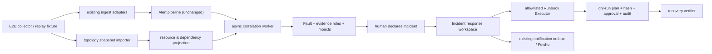

# E2B Failed to place sandbox 黄金场景设计

## 1. 最终目标

以 E2B `500: Failed to place sandbox` 真实故障链为黄金场景，完成 alert-system 的第一个 Infrastructure-first 端到端纵向切片：

```text
E2B 资源/依赖快照 + 指标/日志/合成探针
→ Alert 证据
→ 可解释 Fault
→ 爆炸半径与业务 SLO
→ 人工宣布 Incident
→ 角色/任务/时间线/飞书通报
→ 带审批护栏的 Runbook
→ 恢复判据与观察窗口
```

本地回放是必须门禁，隔离 E2B UAT 实机演练是最终验收。

## 2. 事实、推断与待确认项

### 已有事实

- `Failed to place sandbox` 是包装错误，下层可能是对象缺失、资源耗尽、envd 超时、快照/CPU 不兼容等不同故障。
- 缺失 UFFD 对象且仅残留 `snapshot:last` 时，持续 connect/auto-resume 会制造无效跨节点重试。
- 恢复失败路径可以残留重复/孤儿 Firecracker，进一步占用 CPU、HugePages 和内部槽位。
- Nomad Job 全部 running 不等于用户能成功创建 Sandbox，必须引入产品 SLO 和合成生命周期探针。
- placement attempt 失败数会被同一个用户请求的跨节点重试放大，不能直接当作用户请求失败率。
- 历史上曾出现“失败 attempt 已经很高，但两个模板的 create 仍成功”，随后压力继续放大才击穿创建链。
- F5 上行单向黑洞会造成流式 stall，但与本场景的 placement 资源耗尽不是同一个 Fault；它适合作为 `excluded` 证据验证错误关联的排除能力。

### 待 UAT 前确认

- UAT 的资源范围、测试模板、业务消费方和可接受的故障注入方式。
- 可用的只读指标/日志/拓扑出口，以及执行 cleanup 所需的单独审批链。
- 用于 UAT 状态通报的飞书测试机器人是否仍可用。

## 3. 黄金场景的两阶段叙事

### 阶段 A：技术 Fault，业务尚未中断

1. 一批暂停 Sandbox 的 UFFD 对象缺失，但 snapshot/auto-resume 元数据仍在。
2. 调用方继续 connect，造成快速失败和跨节点 placement attempt。
3. 系统收到日志、失败 attempt、FC/gauge 差值、节点负载等多类 Alert。
4. 关联器形成“无效 Sandbox 恢复重试正在消耗 Orchestrator 池”的 Fault，但 create 合成探针仍成功。
5. UI 显示风险正在放大，提示停止重试和运行只读诊断，不自动建立 Incident。

### 阶段 B：业务 SLO 失守，升级 Incident

1. 恢复失败继续留下重复/孤儿 FC，部分节点 `load1 > nproc`，HugePages 低于启动余量。
2. API 开始出现 `Node exhausted`、envd 60s timeout，用户级 create/resume 合成探针失败。
3. Fault 的爆炸半径从技术风险升级为 E2B Sandbox Runtime 和 Insforge Preview/Runtime 的已确认业务影响。
4. 系统建议宣布 Incident，SRE 确认后进入 Incident Room，分配指挥官、技术处置、通信和业务确认角色。
5. 响应团队先停止无效重试，再生成安全 cleanup 计划，经审批后在 UAT 执行。

## 4. 单次失败、服务 Fault 和 Incident 的边界

`Failed to place sandbox` 必须按观测边界拆开：

| 层级 | E2B 示例 | 含义 | 是否能证明 E2B 服务故障 |
|---|---|---|---|
| Signal | 某个 Orchestrator 节点的一次 placement attempt 失败 | 调度器可能换节点继续尝试 | 不能 |
| Signal | 一个用户 create/connect 请求最终返回 500 | 该请求已失败 | 只证明单次或单 SID 失败 |
| Alert | 5 分钟用户级 create 失败率超阈值，或生命周期探针连续失败 | 可行动的直接退化证据 | 可以支撑能力级 Fault |
| 实例级 Fault | 特定 SID 的 UFFD 对象丢失，无法 resume | 局部实体已发生技术故障 | 不等于整个服务故障 |
| 能力级 Fault | Sandbox Placement/Runtime 无法满足 create/resume SLO | 共享基础设施能力已退化 | 是 |
| Incident | Insforge 等业务受影响，需要跨团队指挥、处置和通报 | 对 Fault 的人工响应容器 | Incident 本身不是故障证据 |

一批实例级 Fault 可以通过 `contributes_to` 关系放大成能力级 Fault。例如，13 个缺对象 SID 本来只是局部恢复失败，但它们的并发 auto-resume 留下重复 FC，最终使共享 Orchestrator 池资源耗尽，才形成“Sandbox Placement 能力退化”。

关联有两条对称路径：

```text
预警路径（自底向上）
CPU/HugePages 压力 + FC/gauge 漂移 + resume 队列上升
→ candidate Fault：Placement 容量有耗尽风险
→ 直接 SLO Alert 出现
→ active capability Fault

事后定界（自顶向下）
用户级 Failed to place 超阈值
→ active capability Fault：Placement 能力已退化
→ 按拓扑回溯近期 Alert/变更/实例 Fault
→ 补齐 cause_candidate、trigger、symptom、supporting、excluded 证据
```

所以系统不是“先有告警才能有 Fault”或“先有 Failed to place 才去找告警”二选一；两个方向最终都收敛到同一个可持续补充、可人工裁决的 Fault 证据图。

## 5. 领域映射

| E2B 对象/信号 | alert-system 对象 | 说明 |
|---|---|---|
| Orchestrator 节点、API、client-proxy、Redis、对象存储 | ResourceNode | 只读投影，带环境、所有者、最后同步时间 |
| Sandbox Scheduling / Runtime | Infrastructure Capability | SRE 向上层业务提供的能力 |
| Insforge Preview/Runtime | Business System | 依赖 E2B Sandbox Runtime 的消费业务 |
| `object does not exist` | Alert / cause_candidate | 缺失恢复对象的根因候选 |
| 同 SID 高频 connect/auto-resume | Alert / trigger | 触发并持续放大故障 |
| FC 数显著高于 running gauge | Alert / supporting | 支持“重复/孤儿残留”的证据 |
| `Node exhausted` / envd timeout | Alert / symptom | 资源耗尽的下游症状 |
| create/pause/resume 探针失败 | Alert / business-impact evidence | 是否升级 Incident 的关键门槛 |
| F5 stream stall | Alert / excluded | 不同因果链，验证人工排除错误关联 |

## 6. 高层架构



关键边界：

- 现有 `dedup → route → group → silence → inhibit` 不改序。
- 关联器只消费已提交 Alert 和拓扑投影，异步生成 Fault 建议，不阻塞告警和通知。
- E2B collector 不携带或输出 Redis URL、API Key、SSH 凭据和完整敏感 metadata。
- Runbook Executor 不接受任意 shell；只接受已注册动作与类型化参数，凭据使用外部 secret reference。

## 7. 实现范围

### 领域与存储

- `resource_nodes`、`dependency_edges`、`topology_sync_runs`。
- `faults`、`fault_alert_links`、`fault_impacts`，支持确认、排除、合并/拆分和人工裁决优先级。
- `incidents`、`incident_fault_links`、`incident_roles`、`incident_tasks`、`incident_timeline_entries`、`recovery_criteria`。
- `runbooks`、`runbook_runs`、`runbook_approvals`；计划内容、SHA256、过期时间、执行者和结果可追溯。

### E2B 接入契约

- 拓扑 fixture：Orchestrator 池、API/client-proxy、Redis/对象存储、Sandbox Runtime 和 Insforge 依赖边。
- 指标证据：placement success/failure attempt、用户级 create/resume 结果、FC/gauge 差值、load/nproc、HugePages 余量。
- 日志证据：脱敏 SID、trace ID、节点 ID、错误分类、耗时和时间；不发送完整 metadata。
- 合成探针：本地使用可控 fake；UAT 使用现有 `sandbox_lifecycle.py` 的 create→pause→resume→delete 契约。

### 核心 API/UI

- 运行总览：E2B 责任能力、拓扑新鲜度、活动 Fault、业务影响和 SLO。
- Fault 工作区：证据角色、节点/资源上下文、放大链、爆炸半径、诊断 Runbook 和宣布 Incident。
- Incident Room：指挥条、统一时间线、角色、任务、飞书通报、恢复判据和受控操作。
- 所有写操作都要有加载、成功、失败、未变更反馈和审计记录。

## 8. Runbook 安全模型

黄金场景注册下列动作：

1. `e2b.stop_invalid_retries`：协作任务，要求填写执行人、工单和停止时间，alert-system 不直接控制业务方重试。
2. `e2b.snapshot_audit`：只读，输出精确 SID 证据和带哈希的短时效计划。
3. `e2b.fc_audit`：只读，查看残留 FC、节点资源和同 SID 新旧进程。
4. `e2b.cleanup_dry_run`：为精确目标生成带 SHA256 和短时效的清理计划，默认不修改外部状态。
5. `e2b.cleanup_apply`：高风险，必须校验计划 SHA256、未过期、重试已停止、审批人与执行人分离，且只调用受支持的 E2B DELETE API。
6. `e2b.lifecycle_verify`：在授权的 UAT 模板上执行 create→pause→resume→delete，无论成功或失败都尽力清理测试 Sandbox。

明确禁止：任意 shell、直接 Redis `DEL`、全池 `pkill firecracker`、全停 Orchestrator、绕过计划哈希或审批。

## 9. 端到端验收契约

### 本地可重复回放（硬门禁）

`TestScenarioE2BFailedToPlaceIncidentLifecycle` 必须验证：

1. 导入 E2B 资源/依赖快照后，能从 Orchestrator 池反向遍历到 E2B Sandbox Runtime 和 Insforge。
2. 阶段 A 事件经现有入站管道落成多条 Alert，被关联为一个 Fault，证据角色和依据正确。
3. 合成 create 仍成功时，Fault 可见但 Incident 数量为 0，UI 不把 attempt 失败率标成用户成功率。
4. 注入阶段 B 的 Node exhausted/envd timeout 和用户级 create 失败后，爆炸半径与业务影响更新，宣布 Incident 的门槛被满足。
5. SRE 宣布 Incident，指定角色和任务，飞书 mock 收到状态通报，时间线中有事实、假设、决策、自动化和通信事件。
6. F5 stall 证据被人工标记为 `excluded`，不进入根因链。
7. cleanup apply 在无计划、哈希不符、计划过期、重试未停止或缺少审批时均被拒绝；正常路径先 dry-run 再 apply。
8. 恢复证据显示失败 attempt 下降、FC/gauge 差值收敛、节点负载恢复、生命周期探针通过，Incident 才能进入 monitoring；观察窗口通过且所有响应任务均为 `done/canceled` 后才能进入 resolved。
9. 全部过程可审计，测试数据定向清理，不留残留 timer、Sandbox 或敏感值。
10. 场景连续运行 3 次均通过，不用长 `sleep` 掩盖竞态。

### E2B UAT 最终验收

- 先运行全部只读 preflight，归档拓扑、版本、节点容量、测试模板和恢复基线。
- 仅在隔离的 UAT SID/模板上制造可回收的恢复失败，不影响生产租户。
- 通过 UI 完成 Fault 证据裁决、Incident 宣布、角色/任务和 Runbook 审批。
- cleanup 执行后按 SOP 实际观察 30 分钟，再运行 create→pause→resume→delete。
- 飞书测试机器人收到宣布、缓解、恢复三次通报，且不暴露凭据、Redis URL 或完整敏感 SID 列表。
- 最终产物包含验收记录、关键证据、清理结果和未解决风险，不包含生产密钥。

## 10. 分阶段交付

1. **场景契约与 fixture**：固化两阶段事件、拓扑快照、预期证据角色和恢复数据。
2. **拓扑与 Fault 纵向切片**：存储、导入、受限遍历、关联、影响和 API。
3. **Incident 协作纵向切片**：宣布、角色、任务、统一时间线、通报和恢复门槛。
4. **受控 Runbook**：白名单执行器、dry-run、计划哈希、审批、审计和 fake E2E executor。
5. **四个核心页面**：运行总览、基础设施详情、Fault 工作区、Incident Room，使用同一份 E2B fixture。
6. **本地全链路验收**：Go E2E、前端构建/lint、核心浏览器旅程和飞书 mock，连续 3 次通过。
7. **UAT 实机验收**：单独授权后执行，完成演练、观察、恢复和清理报告。

截至 2026-08-02，阶段 1～6 已在本地隔离环境完成。`TestScenarioE2BFailedToPlaceIncidentLifecycle` 覆盖拓扑、两阶段 Alert→Fault 关联、爆炸半径、人工证据裁决、人工宣布、重复宣布幂等、四个响应角色、任务、统一时间线、三次 mock 飞书通报、双重关闭门槛与受控 Runbook；黄金场景已连续运行 3 次通过。四个核心页面也已用同一 fixture 完成三轮真实浏览器旅程，并通过用户提供的测试机器人验证 declared/mitigated/resolved 三次可靠通报。Runbook 回归确认审批执行同人被拒绝，独立审批后仅本地 fake executor 执行，`external_mutation=false`，`e2b.lifecycle_verify` 执行次数为 0。

代码侧已补齐默认关闭的真实 UAT 生命周期执行器：显式启动开关、专用 URL/key、环境与模板白名单、短时效授权、IC/TL 角色门禁、HTTPS/host/精确 IP 校验、禁止环境代理、禁止重定向、类型化 create→pause→resume→delete 和 finally 清理均有自动化测试。只读实机预检同时确认当前只有生产环境，`.uat` 域名仍指向生产 ingress，且没有独立 inventory、状态层和测试模板，因此阶段 7 继续保持 **BLOCKED**；详见 `docs/uat/2026-08-02-e2b-uat-preflight.md`。

## 11. 非目标

- 不在 alert-system 内复刻 E2B Dashboard、Grafana、CMDB 或 JumpServer。
- 不尝试在第一版做通用无代码关联引擎；先实现可测、可解释的确定性规则。
- 不让 AI 自动合并 Fault、宣布 Incident 或执行 cleanup。
- 不把直接 Redis 删除、批量 kill FC 或重启全池作为快捷恢复方式。

## 12. 完成信号

```bash
go build ./...
go vet ./...
go test -tags=integration ./... -race -count=1

for run in 1 2 3; do
  go test ./test/e2e/... -run TestScenarioE2BFailedToPlaceIncidentLifecycle -count=1 || exit 1
done

cd web
npm run build
npx oxlint
```

除命令通过外，还必须完成本文第 9 节的领域、UI、安全护栏和 UAT 验收。
