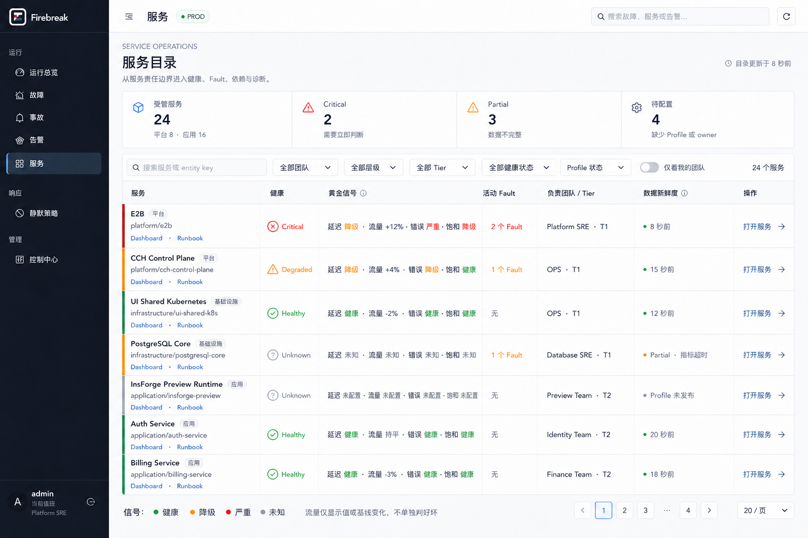
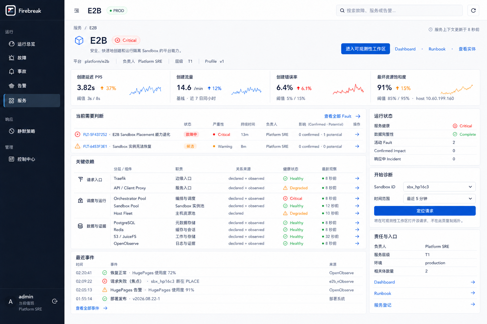
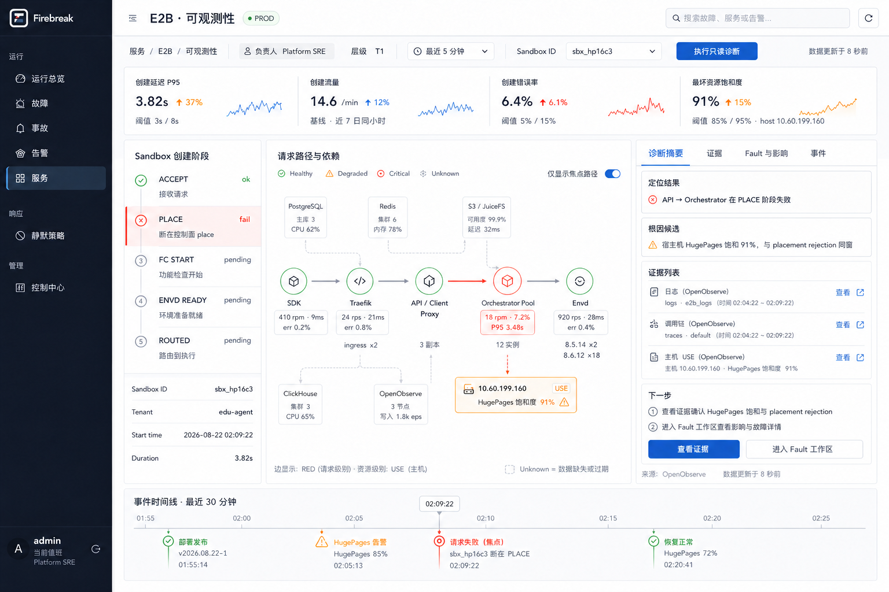
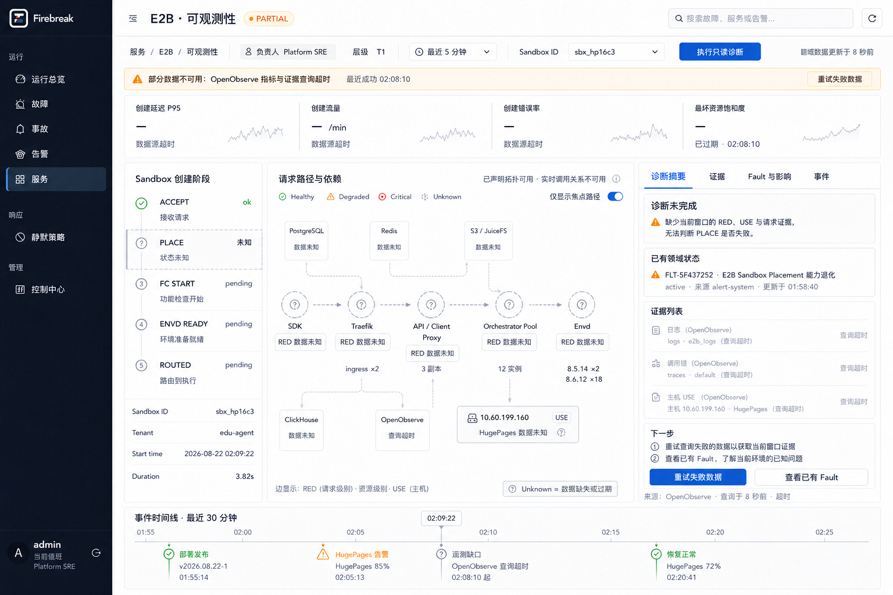
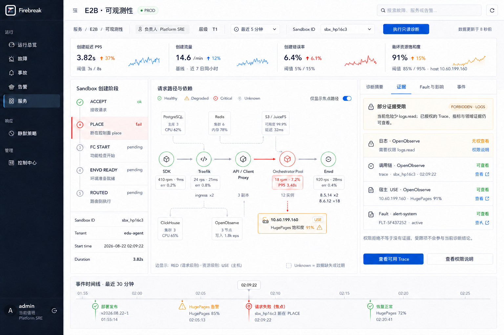

# Service Observability 完整设计与开发交接稿

> 状态：Ready for handoff；设计完成，尚未实现
> 日期：2026-08-22
> 产品归属：alert-system / Firebreak
> 首个案例：E2B
> 用户路由：`/services`
> 决策依据：[ADR-0006](../adr/0006-service-observability-workspaces-and-optional-agent-port.md)
> 机器契约：[Service Observability contracts v1](../contracts/service-observability/v1/README.md)

## 0. 交接结论

完整能力应落在 **alert-system**，而不是 e2b-dashboard、e2b-observe 或一个新的独立服务。

- alert-system 拥有服务登记、canonical topology、Alert/Fault/Impact/Incident、身份、权限和人工裁决；
- E2B 以首个 `ServiceObservabilityProfile` 接入，不在核心代码中增加 E2B 分支；
- Prometheus-compatible 后端提供 Golden/RED/USE 的规范化指标；
- OpenObserve 提供按 `sandbox_id` 关联的 logs/traces/access 证据；
- 页面只消费服务端 Page View，不接触数据源凭据、PromQL、SQL 或原始查询模板；
- Agent 当前不实现。已经稳定的 `DiagnosticContext + ToolDescriptor + EvidenceRef` 就是未来 Agent 的输入边界，基础页面不依赖 Agent。

最终产品形态是三个逐级收敛调查范围的页面：

1. `/services`：跨服务分诊；
2. `/services/:service_id`：服务总览与诊断启动；
3. `/services/:service_id/observability`：动态拓扑与聚焦调查。

## 1. 目标、成功标准与非目标

### 1.1 产品目标

让值班 SRE 从“哪个服务异常”连续走到“哪一跳、哪个资源、哪些证据支持当前判断”，并始终保留责任人、数据可信度和 alert-system 领域状态。

E2B 黄金路径：输入 `sandbox_id=sbx_hp16c3`，定位 `Sandbox Create / PLACE`，发现 `API → Orchestrator` RED 异常，再用宿主 HugePages 使用率与 `ResourceExhausted` 证据形成候选原因，最后进入现有 Fault 工作区，而不是由页面自动宣布 Incident。

### 1.2 成功标准

- 无 Agent 时可独立完成服务分诊、请求聚焦、拓扑定位和证据下钻；
- RED、USE、Google 四大黄金信号的对象归属与含义准确；
- 健康状态与数据状态正交，缺数、超时、过期、无权限不假绿；
- E2B 专属 focus/journey/指标绑定全部位于 Profile；
- 第二个服务只需登记 service、发布 Profile、绑定通用 tools，不复制页面；
- OpenObserve、Prometheus 或 Agent 单独故障均不影响 alert-system 的 Fault/Incident 基础能力；
- 所有页面状态都有可验证 fixture 与验收场景。

### 1.3 本设计明确不做

- 不实现通用 Dashboard builder；
- 不允许服务上传 React/Vue/HTML 插件；
- 不在 alert-system 长期保存原始 logs/traces；
- 不重新实现 Alertmanager 的 Alert 生命周期；
- 不自动把单个 SID 失败升级为服务 Fault 或 Incident；
- 不实现 Agent、模型、prompt、聊天、会话、SSE、多 Agent 或写操作 tools；
- 不把 e2b-observe fixture 数字当成生产事实。

## 2. 事实、推断与未决数据缺口

### 2.1 已确认事实

- alert-system 已有 `GET /api/v1/services`、Service Registration、owner、tier、Dashboard、Runbook、Alias 和 declared dependencies；
- 当前服务创建 handler 固定创建 `application/business_system`，无法正确登记 E2B 这类 `platform/infrastructure_capability`；底层 `service_registrations.entity_id` 本身已能引用通用 `resource_nodes`；
- alert-system 已有 canonical Entity/Relation、Alert、Fault、Impact、Incident 及其权限和时间线；
- e2b-observe 当前是 2026-08-17 模拟快照，不是 live scrape；
- OpenObserve 的 E2B 数据集包括 `e2b_logs`、`e2b_access`、`default` traces，逐条关联字段必须使用 `sandbox_id`，不能使用 collector 提升的 `sandboxid`；
- E2B UAT 已设计 OTLP metrics/派生 RED 双写 OpenObserve 与 Prometheus，node_exporter 主链路由 Prometheus 抓取；未来可以把 Prometheus-compatible endpoint 换成 VictoriaMetrics；
- `e2b_trace` spanmetrics 能提供 RED counter/histogram，但 metric 名需要运行时发现，不能在设计中猜写最终 PromQL 名称；
- node_exporter 能提供 HugePages Total/Free 等资源指标；
- placement admission queue/wait pressure 的直接 saturation 指标目前未确认存在。

### 2.2 设计推断

- 页面应通过后端聚合投影，不能让浏览器分别查询 OpenObserve、Prometheus 与 alert-system 后自行合并；
- 目录必须读取缓存的服务摘要，不能为每一行同步扇出多个遥测查询；
- 工作区可以针对一个服务和一个 focus 做有界实时查询；
- HugePages 使用率可以在 Phase 1 作为 Golden Saturation 的显式 proxy，但 USE 的 `Utilization` 与 `Saturation` 不得使用同一字段伪装；
- `DiagnosticContext` 是稳定事实快照，Page View 是面向路由的显示投影，二者职责不同。

### 2.3 当前必须显式显示的缺口

| 缺口 | 页面行为 | 后续补齐 |
|---|---|---|
| Placement queue/wait pressure 指标未确认 | USE Saturation = Unknown；HugePages 91% 标为容量压力 proxy | 在 Orchestrator 暴露 admission wait/queue/headroom 指标 |
| observed topology 身份可能跨源不一致 | 无法解析的关系进入 Unknown/冲突，不自动并入 canonical graph | 补 EntityAlias 与冲突治理 |
| OpenObserve retention 短 | EvidenceRef 保留摘要/hash/时间；原文过期显示 Expired | 按审计需求确认 retention 与归档策略 |
| E2B 生产 Profile 阈值尚未由 SLO owner 签字 | fixture 阈值只用于设计验收 | owner 审核后发布 Profile v1 |
| Prometheus 长期后端未最终确定 | adapter key 使用 `prometheus_compatible` | 切 VM 时仅替换 provider 配置与模板 |

## 3. 信息架构与视觉稿

### 3.1 `/services` 服务目录

回答“哪个服务现在最需要关注”。默认使用高密度台账，按 Critical、confirmed Impact、active Fault、tier 排序。Health 与 Data 分列；Traffic 只以中性色显示值或基线变化。

### 3.2 `/services/:service_id` 服务总览

回答“发生了什么、谁负责、有哪些领域对象、从哪里开始调查”。显示服务 identity、四大黄金信号、Fault、关键依赖、最近事件和 focus 启动器；不复制完整拓扑。

### 3.3 `/services/:service_id/observability` 工作区

回答“哪一跳、哪个资源、哪些证据解释当前症状”。显示 journey、动态拓扑、边 RED、节点 USE、确定性诊断摘要、EvidenceRef、领域状态与统一时间线。

### 3.4 必须覆盖的异常状态

视觉稿用于布局、密度和状态表达验收；生成图中的小字号文本不是接口规范。完整页面细则见：

- [路由族页面与交互规范](2026-08-22-services-route-family-page-spec.md)
- [工作区页面与交互规范](2026-08-22-service-observability-page-spec.md)
- [视觉稿来源与提示词](../assets/service-observability/README.md)

## 4. 三种可选架构与推荐

### 4.1 方案 A：浏览器直连各数据源

优点是初期代码少；缺点是凭据暴露、跨源权限与审计不一致、浏览器需要理解 PromQL/SQL、Agent 无法安全复用。拒绝。

### 4.2 方案 B：alert-system 直接返回数据源原始结果

优点是服务端集中鉴权；缺点是 UI 仍绑定供应商字段，服务间无法复用，OpenObserve/Prometheus 替换会污染前端。拒绝。

### 4.3 方案 C：Context Assembler + Page View Projector + Typed Adapters

这是推荐方案。数据源 adapter 只产出规范化 signal、topology hint 和 EvidenceRef；Context Assembler 形成只读事实快照；Page View Projector 生成三条路由需要的稳定读模型。未来 Agent 只作为相同 Context/Tools 的可选消费者。

~~~mermaid
flowchart LR
    UI[Firebreak /services 页面族] --> API[Service Observability API]
    API --> PV[Page View Projector]
    PV --> CA[Diagnostic Context Assembler]
    CA --> PR[Profile Registry]
    CA --> TR[Typed Tool Registry]
    CA --> DS[alert-system Domain Store]
    TR --> PM[Prometheus-compatible Adapter]
    TR --> OO[OpenObserve Adapter]
    TR --> TP[Canonical Topology Adapter]
    TR --> DR[Domain Read Adapter]
    PM --> SIG[Golden / RED / USE]
    OO --> EV[Logs / Traces / Access Evidence]
    TP --> TOP[Declared + Observed Topology]
    DS --> DOM[Alert / Fault / Impact / Incident]
    AG[Future optional Agent] -. consumes .-> CA
    AG -. allowed read-only tools .-> TR
~~~

## 5. 核心契约与职责

| 契约 | 权威职责 | 不负责 |
|---|---|---|
| Service Registration | identity、owner、tier、环境、Dashboard/Runbook、aliases、declared dependencies | 查询遥测、定义页面布局 |
| ServiceObservabilityProfile | focus、journey、renderer、semantic signal bindings、阈值、limits、tool refs | 携带 SQL/PromQL、凭据、脚本、prompt |
| DiagnosticContext | 当前身份、service/scope/focus、topology、signals、EvidenceRef、domain state、policy 的只读事实快照 | DOM、视觉格式、Agent 会话 |
| Page View | 目录/总览/工作区的服务端显示投影、section/data status、格式化值与 capabilities | 原始查询、健康重算、领域写入 |
| EvidenceRef | 对源系统证据的有限、可审计引用 | 长期复制原始证据 |
| ToolDescriptor | 受控输入输出、adapter、模板引用、权限、限额、审计、脱敏 | 自由 SQL/Shell/SSH/任意 URL |

机器可读定义：

- [ServiceObservabilityProfile schema](../contracts/service-observability/v1/service-observability-profile.schema.json)
- [DiagnosticContext schema](../contracts/service-observability/v1/diagnostic-context.schema.json)
- [Page View schema](../contracts/service-observability/v1/service-observability-page-view.schema.json)
- [EvidenceRef schema](../contracts/service-observability/v1/evidence-ref.schema.json)
- [ToolDescriptor schema](../contracts/service-observability/v1/tool-descriptor.schema.json)

E2B fixtures：

- [Profile](../contracts/service-observability/v1/examples/e2b.profile.json)
- [DiagnosticContext](../contracts/service-observability/v1/examples/e2b.context.json)
- [Directory View](../contracts/service-observability/v1/examples/e2b.directory-view.json)
- [Overview View](../contracts/service-observability/v1/examples/e2b.overview-view.json)
- [Workspace View](../contracts/service-observability/v1/examples/e2b.workspace-view.json)
- [Workspace state scenarios](../contracts/service-observability/v1/examples/e2b.workspace-scenarios.json)
- [Tool catalog](../contracts/service-observability/v1/examples/tool-catalog.json)
- [Contract verifier](../contracts/service-observability/v1/verify_examples.py)

## 6. RED、USE 与四大黄金信号

### 6.1 固定语义

| 方法 | 对象 | 指标 | 页面问题 |
|---|---|---|---|
| Google 四大黄金信号 | 服务/用户旅程 | Latency、Traffic、Errors、Saturation | 用户是否受影响？ |
| RED | 服务节点与实际调用边 | Rate、Errors、Duration | 哪个服务或哪一跳异常？ |
| USE | 主机、池、队列、存储等资源 | Utilization、Saturation、Errors | 哪个资源约束正在逼近或拒绝工作？ |

Traffic 与 Rate 没有方向性阈值时状态必须为 `neutral`，不能因为上升显示绿色或红色。Health 聚合忽略 neutral，但仍展示数值和基线变化。

### 6.2 E2B 规范映射

| Slot | E2B 指标 | 首选来源 | 计算/阈值 | 当前状态 |
|---|---|---|---|---|
| Golden Latency | Sandbox create P95 | Prometheus `e2b_trace` histogram | p95；3s degraded / 8s critical（待 owner 签字） | 可查询 |
| Golden Traffic | creates/min | Prometheus RED counter | rate；仅与 7d 同时段基线比较，中性 | 可查询 |
| Golden Errors | create error % | Prometheus RED counter | failures / attempts；5% / 15%（待签字） | 可查询 |
| Golden Saturation | 最坏宿主容量压力 | Prometheus node_exporter | Phase 1 用 HugePages utilization max 代理；85% / 95% | proxy，必须标识 |
| RED Rate | API → Orchestrator req/s | Prometheus spanmetrics | rate | 可查询 |
| RED Errors | API → Orchestrator error % | Prometheus spanmetrics | error / total；2% / 5% | 可查询 |
| RED Duration | API → Orchestrator P95 | Prometheus histogram | histogram_quantile；1s / 3s | 可查询 |
| USE Utilization | HugePages used / total | Prometheus node_exporter | `(Total-Free)/Total`；按 host 展示，服务取 max | 可查询 |
| USE Saturation | placement admission wait/queue pressure | Orchestrator 指标 | 不得复用 utilization；未接入时 Unknown | 缺口 |
| USE Errors | ResourceExhausted/rejection % | Prometheus counter 或规范化日志指标 | rejected / attempts；1% / 5% | 需确认生产 metric |

`HugePages 91%` 的规范文案是“使用率 91%”或“容量压力 proxy 91%”。只有具备 admission wait/queue/headroom 的直接指标后，才能在 USE 明细中称为真实 saturation。

### 6.3 Health 派生

1. 只评估 `availability=available` 且 freshness 未超 Profile TTL 的信号；
2. 任一 eligible signal 为 Critical，服务 Health = Critical；
3. 否则任一 eligible signal 为 Degraded，Health = Degraded；
4. 否则任一 required signal 缺失、过期、Forbidden 或 Unavailable，Health = Unknown；
5. 只有全部 required signals 可用且均未越阈值，Health = Healthy；
6. Traffic/Rate 的 `neutral` 不参与 worst-of 聚合；
7. Fault/Incident 数量单独展示，不直接改写信号健康；
8. `reason_codes` 必须列出导致最终状态的 signal binding，禁止神秘综合分数。

## 7. 数据源与页面区域映射

| 页面区域 | View Model 字段 | 来源 | 失败后的最小降级 |
|---|---|---|---|
| Service identity | `service` | alert-system Service Registration / team | service 本身不可读才整页 403/404 |
| Profile/Focus | `profile`, `focus_kinds` | file-based Profile Registry | 总览显示 Unconfigured；工作区不猜配置 |
| Directory Health/Data | `health`, `data_status` | snapshot cache | 返回 stale snapshot 并显式 Stale |
| Golden | `golden_signals` | Prometheus-compatible adapter | 对应信号 Unknown；其它区块保留 |
| Journey | `journey` | Profile + OpenObserve traces/logs | 阶段 Unknown，不伪造完成路径 |
| Declared topology | `topology` declared | canonical Entity/Relation | Profile root 仍可显示；缺关系为 Unknown |
| Observed path | topology observed overlay | OpenObserve traces + alias resolver | 灰色虚线/Unknown；declared topology 保留 |
| 边 RED | relation `signals` | Prometheus spanmetrics | 该边 RED Unknown，不把边画绿 |
| 节点 USE | node `signals` | Prometheus node/resource metrics | 单资源 Unknown，其它资源保留 |
| Evidence | `evidence_refs` | OpenObserve / Prometheus / domain | 单类 Unavailable/Forbidden/Expired |
| Fault/Impact/Incident | `domain_state`, counts | alert-system | 保留最后已提交领域状态；查询失败单块 Partial |
| Timeline | `timeline` | domain/change/deploy/telemetry gap adapters | 标记缺失来源，不重排已返回事件 |
| Deterministic summary | `diagnostic_summary` | server rules over normalized facts | 缺证据时 level=`incomplete` |

## 8. Page View 与 API 设计

现有 `GET /api/v1/services` 保持轻量 Service Registration API，供控制中心和既有调用方使用。新增独立只读聚合边界：

| API | 用途 | 响应 |
|---|---|---|
| `GET /api/v1/service-observability` | 服务目录 | `view_kind=service_directory` |
| `GET /api/v1/service-observability/:service_id` | 服务总览 | `view_kind=service_overview` |
| `GET /api/v1/service-observability/:service_id/workspace` | 聚焦工作区 | `view_kind=observability_workspace` |

### 8.1 目录查询

~~~text
GET /api/v1/service-observability
  ?environment=production
  &team_id=...
  &tier=tier-1
  &health=critical,degraded
  &data_status=complete,partial
  &q=e2b
  &sort=health
  &cursor=...
  &limit=50
~~~

- 默认最多 50，硬上限 200；
- cursor 表达稳定排序位置，不接受任意 SQL 排序；
- 默认读取摘要 cache，不能对每一行现场并发查询全部数据源；
- 返回的 `assembled_at` 与每行 `observed_at` 分开。

### 8.2 总览查询

~~~text
GET /api/v1/service-observability/{service_id}
  ?environment=production
  &window_seconds=300
~~~

- 服务 identity/domain 优先；
- 内部可并行读取 Golden、dependencies、Faults、events；
- 单 section 失败仍返回 200，并通过 `sections[]` 与 `data_status` 表达；
- Profile 未配置时返回基础总览、`profile=null`、Data=`unconfigured`。

### 8.3 工作区查询

~~~text
GET /api/v1/service-observability/{service_id}/workspace
  ?environment=production
  &focus_kind=sandbox_id
  &focus_value=sbx_hp16c3
  &from=2026-08-22T02:04:22Z
  &to=2026-08-22T02:09:22Z
~~~

- focus kind/value 必须满足已发布 Profile；
- `from/to` 使用绝对 UTC，timezone 仅用于显示；
- URL 不包含 token、PromQL、SQL、证据正文或角色；
- 无 focus 时返回服务级 declared topology，不伪造 observed request path；
- 请求超出 Profile/global limit 返回 422，不静默截断；
- 服务端重新根据当前 session 计算 capabilities 与 EvidenceRef 可见性。

### 8.4 HTTP 与 section 状态

| 条件 | HTTP | View 状态 |
|---|---:|---|
| 可访问，所有来源完成 | 200 | Data Complete |
| 可访问，某来源超时/失败/Forbidden | 200 | Data Partial；最小 section/source 标状态 |
| 可访问，缓存超过 TTL 但仍可展示 | 200 | Data Stale；显示 observed_at |
| Service 可见但 Profile 未配置 | 200（总览）/ 409（工作区） | Unconfigured |
| focus 格式非法 | 422 | `invalid_focus` |
| 时间窗/基数超限 | 422 | `scope_too_broad` |
| 无权知道该 Service | 403 或统一 404 | 不泄露服务存在性 |
| Service 不存在 | 404 | `service_not_found` |
| Service Registry/认证等关键依赖不可用 | 503 | 页面级 Error |

局部来源错误不使用 HTTP 500；`reason_code` 使用稳定机器码，用户文案由前端本地化。

## 9. 服务端组件边界

### 9.1 推荐 package

~~~text
internal/serviceobs/
  profile/       # file registry、schema/reference validation、published version
  context/       # DiagnosticContext assembler
  view/          # directory/overview/workspace projectors
  health/        # RED/USE/Golden threshold evaluation
  diagnose/      # deterministic evidence rules
  tools/         # registry、authorization、limits、audit
  adapters/
    prometheus/  # semantic signal query templates
    openobserve/ # focus、logs、traces、access、EvidenceRef
    topology/    # canonical nodes/relations + alias resolution
    domain/      # Alert/Fault/Impact/Incident reads
  cache/         # snapshot interface + stale-while-revalidate
internal/api/service_observability.go
~~~

目录名只是建议；依赖方向必须保持：`api → view/context → ports`，adapter 实现依赖 ports，核心不能 import E2B 私有包。

### 9.2 Profile Registry

Phase 1 推荐 file-based registry：

- Profile 以 JSON 随 alert-system 发布；
- 启动时校验 JSON Schema、service/root entity/tool refs、唯一 primary focus、view/signal 引用完整性；
- 校验失败的 Profile 不发布，服务总览显示 Unconfigured/配置错误；
- 同一 service 只能有一个 active published profile；
- 不在 Phase 1 建 Profile 可视化编辑器或数据库表。

### 9.3 Tool Registry

- tool key + semantic major version 唯一；
- `source_adapter` 由服务端 registry allowlist 解析；
- 每次调用取 Profile limit、Tool limit、RBAC limit、global limit 的最小值；
- query template 在服务端代码/配置中，Profile 与浏览器只能传语义 key；
- 所有调用审计 request_id、actor、service、profile version、tool key、duration、row/cardinality、结果状态；
- 审计不保存 token、原始日志正文或未经脱敏的 tool input。

### 9.4 Snapshot Cache

目录读取 `ServiceObservationSummary` cache，避免 N×source fan-out：

- cache key：service_id + environment + profile_version + default_window；
- value：Health、Data、四大信号 compact 值、domain counts、observed_at；
- 默认 TTL 30–60 秒，允许 stale-while-revalidate；
- refresh 采用 bounded concurrency、singleflight、jitter；
- Phase 1 可以使用进程内实现；接口必须允许后续替换 PostgreSQL snapshot store；
- cache 中不保存原始 logs/traces 或敏感 Evidence 内容。

## 10. Service Registration 泛化

当前表结构已经允许 Service Registration 引用任意 `resource_nodes`，真正的限制在创建 API/表单固定 `application/business_system`。

推荐兼容扩展：

~~~ts
interface ServiceRequestV2 extends ServiceRequestV1 {
  entity_layer?: "platform" | "application";
  entity_kind?: "infrastructure_capability" | "business_system";
}
~~~

规则：

- 缺省仍是 `application/business_system`，不破坏现有调用方；
- `platform` 必须配 `infrastructure_capability`；
- `application` 必须配 `business_system`；
- 不允许把底层单台 resource 直接当作服务登记；
- E2B 登记为 `platform/infrastructure_capability`，Profile roots 指向 API、Orchestrator 等 canonical entities；
- 控制中心表单增加“服务类型”，但产品 `/services` 不按类型拆成不同页面。

## 11. Topology 合并与交互语义

### 11.1 两类关系

- `declared`：服务负责人登记的结构依赖，数据缺失时仍保留；
- `observed`：当前时间窗 traces/discovery 实际观察到的关系，有 freshness TTL；
- 同一 canonical relation 同时存在时投影为 `declared_and_observed`；
- 无法解析 alias 的 observed relation 不自动建实体，进入治理/Unknown。

### 11.2 方向

canonical dependency 统一为 consumer/caller → provider/callee。Fault 爆炸半径仍从 provider 沿反向关系遍历。页面箭头表示请求/依赖方向，不改变领域遍历规则。

### 11.3 Focus overlay

- 无 focus：显示 bounded service neighborhood；
- 有 focus：声明拓扑作为底图，实际请求路径加粗；
- 未观察到不等于不存在，未命中边变灰而不是删除；
- Journey stage 保留 canonical entity/relation refs，即使它们因 bounded projection 或尚未到达而不在当前拓扑中；筛选只取交集，空交集显示明确 Empty，不临时造图；
- 点击 stage/node/relation 只改变选中与过滤，不产生写入；
- 画布必须有等价表格视图与键盘操作。

## 12. 状态模型

### 12.1 四个正交维度

| 维度 | 值 | 含义 |
|---|---|---|
| Health | Healthy / Degraded / Critical / Unknown | 当前有效信号的运行健康 |
| Data | Complete / Partial / Stale / Unconfigured | 页面数据覆盖与新鲜度 |
| Availability | Available / Empty / Unknown / Forbidden / Unavailable | 单来源、section、值或证据可用性 |
| Freshness | Fresh / Stale / Unknown | 当前观测时间是否仍在 TTL 内 |

### 12.2 关键失败矩阵

| 场景 | 保留 | 变更 | 禁止 |
|---|---|---|---|
| OpenObserve 超时 | Prometheus signals、declared topology、domain | observed path/logs/traces Unavailable；Data Partial | 把无证据当健康 |
| Prometheus 超时 | OpenObserve path/evidence、declared topology、domain | Golden/RED/USE Unknown；Data Partial | 复用旧绿值 |
| 两者超时 | identity、declared topology、domain | 全动态观测 Unknown；summary incomplete | 清空整页、给根因结论 |
| `logs.read` 缺失 | metrics、Trace、Fault | 仅 logs Evidence Forbidden | 显示 0 条日志或泄露数量 |
| Evidence 过 retention | 摘要、hash、observed_at | availability=expired/unavailable | 解释为不存在 |
| observed relation stale | declared edge、最后时间 | observed overlay 灰色虚线 | 保持绿色实线 |
| focus 查询成功无结果 | service 默认拓扑、查询范围 | Empty | 发明 journey/path |
| Profile 缺失 | identity、owner、domain、links | Data Unconfigured | 猜指标/页面 |

## 13. 确定性诊断规则

| Level | 允许条件 | E2B 文案 |
|---|---|---|
| observation | 一项权威信号或事件 | PLACE 返回 ResourceExhausted |
| correlation | 多项同窗事实，无直接因果 | HugePages 91% 与 rejection 同窗 |
| candidate_cause | 资源信号 + 直接错误证据 + 可解释路径 | 宿主资源不足是 PLACE 失败候选原因 |
| confirmed_cause | canonical Fault 人工确认或明确因果证据 | 由 Fault 工作区确认 |
| incomplete | 必需来源缺失/冲突 | 诊断未完成，缺少 traces/logs |

页面不显示模型式置信度百分比。候选原因必须列 evidence ids 与 missing requirements。已有 Fault 可展示，但不能把历史结论未经当前证据验证直接继承到新 focus。

## 14. 权限、安全与证据

- 浏览器从不获得 OpenObserve/Prometheus 凭据；
- service/tenant/team/actor/roles 从 session 与服务端目录解析，不信任 URL 自报；
- focus value、日志正文、trace attributes、Alert annotations 均视为不可信输入；
- tool 输入先过 schema、时间窗、基数、行数、字符串长度、服务范围校验；
- Evidence deep link 由 alert-system 生成并在打开时再次鉴权；
- Forbidden 必须作用在最小 Evidence/section，不把可见服务整页变 403；
- `logs.read`、`traces.read`、`metrics.read`、`faults.read` 分离；
- 原始日志默认不进入 DiagnosticContext，只返回脱敏摘要与 locator；
- Profile 禁止携带 query、URL header、secret、prompt、HTML 或可执行代码；
- 任何未来写工具都需要新 ADR、审批与审计，不得复用本设计的只读 tool 名义绕过。

## 15. Agent 扩展边界

本阶段真正需要实现的“Agent 抽象”只有三项稳定能力：

1. `DiagnosticContextProvider`：按当前身份提供版本化只读事实；
2. `ToolRegistry`：返回当前允许的只读 ToolDescriptor，并执行受限调用；
3. UI extension slot：未配置 provider 时完全不渲染、不占布局。

未来 Assistant Provider 只能接收：

~~~ts
interface AssistantExtensionInputV1 {
  context: DiagnosticContextV1;
  allowed_tools: ToolDescriptorV1[];
}
~~~

当前不定义 Agent HTTP API、stream event、session、memory、prompt 或 output schema，避免在方案未确定前锁死框架。Agent 关闭、故障或替换时，三层页面、证据、Fault 与 Incident 必须完整可用。

## 16. 非功能目标

| 类别 | 目标 |
|---|---|
| 目录 | 50 行 p95 ≤ 2s；优先 cache；不触发无界扇出 |
| 总览核心 | identity/owner/domain p95 ≤ 1s |
| 总览完整 | 默认 5 分钟窗口 p95 ≤ 3s；局部失败返回 Partial |
| 工作区 | shell/core p95 ≤ 1s；动态 context p95 ≤ 5s；整体 deadline 6s |
| Adapter | alert-system/topology 3s；Prometheus/OpenObserve 5s；可独立取消 |
| 限界 | 默认 ≤100 nodes、≤200 relations、≤200 rows、≤100 EvidenceRefs |
| 新鲜度 | 100% signal/evidence/observed relation 带 observed_at + freshness |
| 审计 | 100% tool 调用带 request_id/actor/service/profile/tool/result status |
| 可用性 | 单 adapter/section 失败不影响其它 section 与 Fault/Incident 页面 |
| 可访问性 | 状态不用单一颜色；拓扑有表格等价视图；完整键盘焦点 |

这些是设计目标，不是已测得的现状；开发完成后必须以 API/浏览器性能测试验证。

## 17. 推荐开发顺序

### Phase 1：契约驱动 UI（fixture）

1. 加入 `/services` 与两条子路由；
2. 用三份 Page View fixture 实现 Directory、Overview、Workspace；
3. 从 `e2b.workspace-scenarios.json` 应用 RFC 6902 patch，完成 main、Partial/Unknown、logs Forbidden、focus empty、stale relation 状态；
4. 不接真实数据源，不改领域状态，不显示 Agent；
5. 以 5 张视觉稿做同视口 design QA。

### Phase 2：alert-system 基础数据

1. 泛化 Service Registration 的 layer/kind；
2. 实现 file-based Profile Registry 与启动校验；
3. 实现 Page View Projector、Health/Data evaluator；
4. 接 Service Registration、canonical topology、Fault/Impact/Incident；
5. 实现 snapshot cache 与 stale-while-revalidate。

### Phase 3：真实只读遥测

1. 实现 Prometheus-compatible semantic signal adapter；
2. 实现 OpenObserve focus/log/trace/access adapter；
3. 实现 EvidenceRef broker、RBAC、审计、限额与取消；
4. 用 UAT 的 `sandbox_id` 只读回放校验，不向生产注入故障；
5. 确认实际 metric names、labels、retention 与阈值后发布 E2B Profile v1。

### Phase 4：第二服务验证

选择与 E2B 结构不同的服务，例如 PostgreSQL 或共享 Kubernetes，验证无核心分支地接入。只有通过第二服务后，contracts v1 从 Draft 进入 Stable。

### Phase 5：可选 Agent

另开 ADR 决定 provider、协议、session、输出、安全与成本；不得与前三阶段并行耦合实现。

## 18. alert-system 文件级实施地图

### 后端

- `internal/domain/`：补 Service Registration layer/kind 合法组合；不新增 E2B 类型；
- `internal/api/service_catalog.go`：兼容扩展 ServiceRequest；
- `internal/serviceobs/`：新增 profile/context/view/health/diagnose/tools/adapters/cache；
- `internal/api/service_observability.go`：新增三个只读聚合 API；
- `internal/app/`：装配 registry、adapters、cache；
- `docs/contracts/service-observability/v1/`：作为实现契约来源。

### 前端

- `web/src/App.tsx`：注册三层路由；
- `web/src/pages/ServiceDirectory.tsx`：从现有静态目录升级为运营目录；
- 新增 `web/src/pages/ServiceOverview.tsx`；
- 新增 `web/src/pages/ServiceObservabilityWorkspace.tsx`；
- 新增通用 `GoldenLedger`、`JourneyRail`、`TopologyCanvas`、`TopologyTable`、`EvidenceList`、`DomainTimeline`、`DataStatusBadge`；
- `web/src/api/client.ts`：生成/声明 Page View types 与三个 API；
- 复用现有 Firebreak shell、颜色、排版与导航，不引入第二套设计系统。

### 测试

- Schema/fixture validation；
- Profile 引用完整性与非法 query/secret 拒绝；
- Health/Data truth table；
- Traffic neutral 与 proxy 标识；
- adapter timeout/Forbidden/Empty/Stale；
- API RBAC、scope limit、取消和无泄露；
- React route、筛选恢复、focus URL、局部重试、键盘与表格拓扑；
- UAT 只读 smoke：Prometheus signals、OpenObserve `sandbox_id` EvidenceRef、Fault deep link。

## 19. 完成定义与验收矩阵

### 19.1 产品验收

- [ ] `/services` 能区分 Health 与 Data，并按可解释规则分诊；
- [ ] `/services/:id` 能在 10 秒内回答责任、影响、Fault、依赖和下一步；
- [ ] `/observability` 能聚焦 `sbx_hp16c3` 并定位 PLACE / API → Orchestrator；
- [ ] RED 只在服务/边，USE 只在资源，Golden 在服务/旅程；
- [ ] Traffic 中性；HugePages proxy 明示；真实 USE Saturation 缺失时为 Unknown；
- [ ] declared/observed topology 可区分；
- [ ] Partial、Unknown、Stale、Forbidden、Empty 均不假绿；
- [ ] 无 Agent 可完成调查；页面无 Agent 占位噪声。

### 19.2 架构验收

- [ ] 核心 renderer/assembler 没有 `if service == e2b`；
- [ ] 浏览器没有数据源凭据、PromQL、SQL、ToolDescriptor 内部模板；
- [ ] 三页 Health 来自同一服务端 evaluator；
- [ ] Page View、Context、Profile、Evidence、Tool fixtures 通过 schema；
- [ ] `GET /api/v1/services` 既有调用方不破坏；
- [ ] 单 adapter 故障只影响对应 source/section；
- [ ] 第二服务可仅通过 registration/profile/tools 接入。

### 19.3 数据验收

- [ ] 生产使用逐条 `sandbox_id`，拒绝 `sandboxid` 混用；
- [ ] RED histogram 实际名称与 labels 经运行时 discovery 固化；
- [ ] HugePages Total/Free 公式、host alias 与 IP 映射验证；
- [ ] placement rejection metric 与日志语义对齐；
- [ ] retention、observed_at、timezone、freshness TTL 可审计；
- [ ] SLO owner 对 E2B thresholds 与 proxy 签字。

## 20. 风险与缓解

| 风险 | 结果 | 缓解 |
|---|---|---|
| 目录按请求扇出所有数据源 | 慢、放大故障 | snapshot cache + bounded refresh |
| 把双写误认为双重事实 | 序列重复/数值冲突 | Profile 每个 binding 只选一个 query provider；另一份仅作证据/灾备 |
| 使用动态 SID/trace_id 作 metric label | 高基数爆炸 | focus 只查 logs/traces；metrics 仅白名单低基数维度 |
| observed topology 自动建实体 | 图污染与错误影响传播 | Alias resolver 冲突 fail closed，进入治理队列 |
| 历史绿值覆盖当前失败 | 假绿 | freshness + Data Stale，Health required-missing → Unknown |
| Profile 变成脚本插件 | 安全与维护失控 | schema allowlist renderer/tool refs，禁止 executable/query |
| Agent 抢先绑定架构 | 基础能力被模型依赖 | 只稳定 Context/Tools；Agent 另开 ADR |

## 21. 理论来源与业界参考

### 21.1 方法论来源

| 来源 | 原始要点 | 本设计中的落点 |
|---|---|---|
| [Google SRE：Monitoring Distributed Systems](https://sre.google/sre-book/monitoring-distributed-systems/) | 面向用户系统的 Latency、Traffic、Errors、Saturation | 服务目录与总览的四张 Golden 卡；Saturation 可以是明确标注的间接信号，但不能伪装成直接 queue pressure |
| [Brendan Gregg：The USE Method](https://www.brendangregg.com/usemethod.html) | 对每类资源检查 Utilization、Saturation、Errors；Saturation 通常表现为排队或等待 | USE 只落在 Host/Fleet/Queue/Pool 等资源；HugePages utilization 与 placement wait/queue 被拆成两个 slot |
| [Tom Wilkie：The RED Method](https://grafana.com/files/grafanacon_eu_2018/Tom_Wilkie_GrafanaCon_EU_2018.pdf) | 对请求型服务统一观察 Rate、Errors、Duration | 服务节点和实际调用边使用同一 RED 语义；Rate 默认中性，不把“流量增长”当健康或故障 |

### 21.2 产品案例

| 案例 | 值得吸收的模式 | 本设计的取舍 |
|---|---|---|
| [PagerDuty Service Directory](https://support.pagerduty.com/main/docs/service-directory) | 可搜索的服务总表、owner/team、Incident 相关筛选与可分享 URL | `/services` 先做跨服务分诊；增加 Health/Data 正交列，避免把遥测缺失混成服务健康 |
| [Datadog Service Map](https://docs.datadoghq.com/tracing/services/services_map/) | observed dependencies、环境/时间范围、节点检查与遥测下钻 | 工作区支持 focus + time range + observed overlay；canonical declared topology 不因 trace 缺失而消失 |
| [New Relic Service Map](https://docs.newrelic.com/docs/new-relic-solutions/new-relic-one/ui-data/service-maps/service-maps/) | 将应用、数据库、主机和外部服务放入统一依赖图，并以 distributed tracing 增强关系 | 采用统一 Entity/Relation 投影，但 observed identity 必须经过 alias resolver，不能自动污染 canonical graph |
| [Grafana Service Graph](https://grafana.com/docs/grafana/latest/datasources/tempo/service-graph/) | graph 与 RED 表并列；trace 关系经 metrics pipeline 写入 Prometheus-compatible 后端 | RED 读取 Prometheus-compatible spanmetrics，Trace 作为 Evidence/observed path；浏览器不直接拼查询 |
| [Datadog Service Page](https://docs.datadoghq.com/tracing/services/service_page/) | 从服务页查看健康、依赖、请求量、错误率、延迟并下钻 | `/services/:id` 保留责任、Fault、Golden 与依赖摘要，完整动态图放到下一级工作区，避免一页过载 |

这些案例是交互与信息架构参考，不是供应商兼容目标。Health/Data 正交、canonical/observed 合并、EvidenceRef、确定性诊断以及可拔插 Agent 端口是本设计针对 alert-system 领域边界做出的组合推断。

## 22. 开发会话的起点

接手开发时按以下顺序读取：

1. 本文；
2. [ADR-0006](../adr/0006-service-observability-workspaces-and-optional-agent-port.md)；
3. [路由族规范](2026-08-22-services-route-family-page-spec.md) 与 [工作区页面规范](2026-08-22-service-observability-page-spec.md)；
4. [contracts v1 README](../contracts/service-observability/v1/README.md) 及三份 Page View fixture；
5. `web/src/pages/ServiceDirectory.tsx`、`internal/api/service_catalog.go`、`internal/store/service_catalog.go`；
6. E2B UAT 双写依据：[OTel/Prometheus ADR](../adr/2026-08-13-otel-prometheus-dual-write-demo.md)。

第一张开发切片应是“用 fixtures 实现三层路由及全部状态”，不要一开始连接生产 OpenObserve，也不要实现 Agent。
