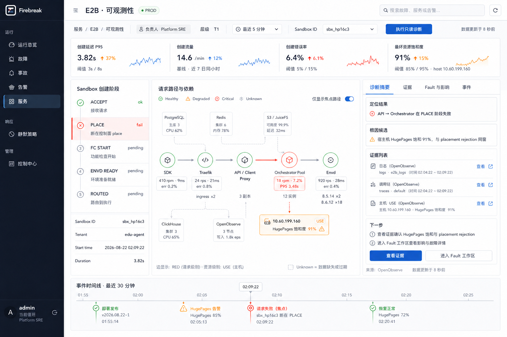
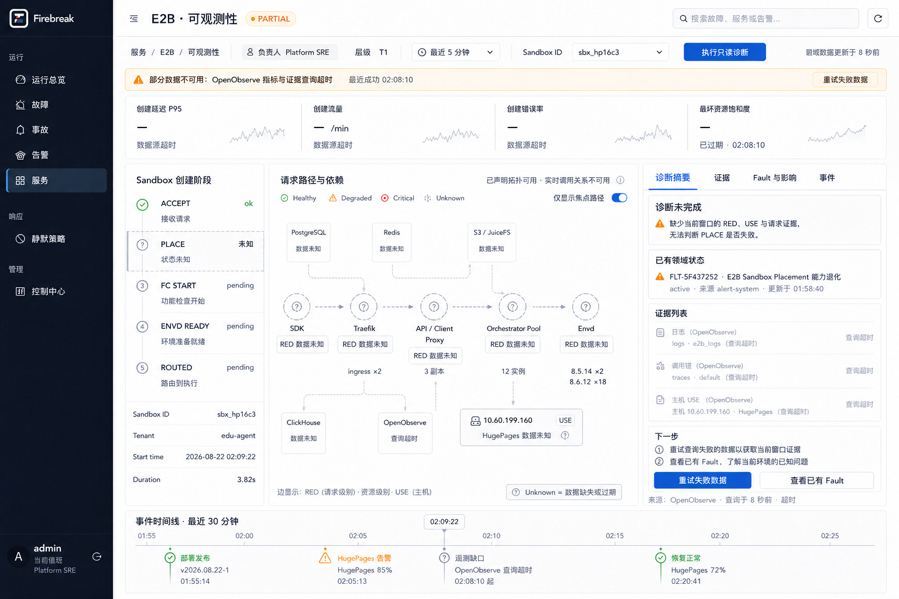
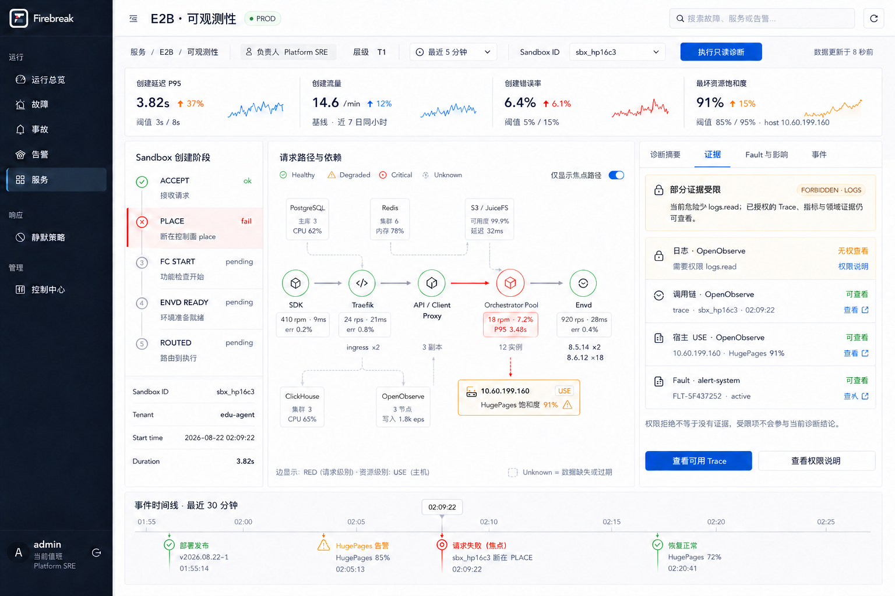

# Service Observability Workspace 页面与交互规范

> 状态：Proposed
> 日期：2026-08-22
> 完整交接稿：[Service Observability 完整设计与开发交接稿](2026-08-22-service-observability-complete-design-handoff.md)
> 适用路由：/services/:service_id/observability
> 前置决策：[ADR-0006](../adr/0006-service-observability-workspaces-and-optional-agent-port.md)
> 数据契约：[Service Observability v1](../contracts/service-observability/v1/README.md)
> 范围：桌面端页面结构、交互、状态语义和视觉验收；不包含前后端或 Agent 实现

## 1. 页面目标

Service Observability Workspace 不是通用指标大盘，也不是独立的 E2B 控制台。它是 Firebreak 中面向单个服务的调查工作区，帮助值班人员完成一条连续路径：

1. 判断用户旅程是否受到影响；
2. 在服务节点或请求边上定位 RED 异常；
3. 下钻资源 USE，验证资源约束；
4. 查看可回溯 EvidenceRef；
5. 进入现有 Fault/Impact/Incident 领域工作流。

E2B 是第一个 profile。主验收场景为：输入 sandbox_id sbx_hp16c3，定位 Sandbox Create 的 PLACE 阶段，发现 API 到 Orchestrator 异常边，并用宿主机 HugePages 与 placement rejection 证据验证候选原因。

整个场景必须在没有 Agent 的情况下完成。Agent extension slot 当前不可见。

## 2. 视觉基准

### 2.1 聚焦失败主状态

### 2.2 Partial 与 Unknown

### 2.3 局部 Forbidden

这些图片用于信息层级、布局、密度和状态表达验收。图片中的小字号文案不是接口字段定义；实现以本文、Profile 和 JSON Schema 为准。

## 3. Firebreak 视觉约束

| 项目 | 规范 |
|---|---|
| 应用外壳 | 复用现有 Firebreak 深色侧栏、64px 顶栏和全局搜索 |
| 内容画布 | #f4f6f8 |
| 主表面 | 白色；1px #d9dee6 或 #cfd5dc 分隔 |
| 导航底色 | #111827；选中态 #24364a 与蓝色左边线 |
| 主操作色 | #315b7d |
| 关键故障路径 | #c7352c 或 Firebreak signal #f05a33 |
| Warning | #d97706 |
| Healthy | #2f7d4b |
| Unknown | 中性灰；虚线轮廓或虚线关系 |
| 圆角 | 主要表面 3–6px；不用大圆角容器 |
| 阴影 | 默认不用；只用边界、间距和表面色分组 |
| 字体 | Avenir Next、PingFang SC；数字使用等宽或 tabular nums |

健康不能只靠颜色表达。状态必须同时包含图标、文本和必要的线型变化。

## 4. 桌面布局

### 4.1 1536 × 1024 基准

| 区域 | 建议尺寸 | 说明 |
|---|---:|---|
| 主导航 | 208px | 复用 AppLayout；服务菜单选中 |
| 顶栏 | 64px | 标题、环境、全局搜索、刷新 |
| 内容内边距 | 18px | 与现有 Operations 页面一致 |
| 服务命令栏 | 44–48px | 面包屑、owner、tier、时间窗、focus、只读诊断 |
| 黄金信号账本 | 112–120px | 四等分，不嵌套卡片 |
| 左侧 journey | 220–248px | 单一阶段轨道与请求事实 |
| 中央拓扑 | minmax(560px, 1fr) | 主调查画布 |
| 右侧上下文 | 340–400px | 摘要、证据、Fault 与事件 |
| 主区间距 | 8px | 形成连续工作台，不制造卡片墙 |
| 底部时间线 | 140–164px | 横跨主内容区 |

主区推荐网格：

- 左列：clamp(220px, 17vw, 248px)
- 中列：minmax(560px, 1fr)
- 右列：clamp(340px, 28vw, 400px)

### 4.2 响应式行为

| 宽度 | 行为 |
|---|---|
| ≥1440px | 完整三列 |
| 1180–1439px | 左列 220px；右侧上下文改为覆盖式 Drawer；中央拓扑优先 |
| 901–1179px | journey 改为顶部可折叠阶段条；上下文使用 Drawer |
| ≤900px | 使用现有移动导航 Drawer；黄金信号两列；拓扑与关系列表切换；不强行缩放桌面画布 |

第一阶段以 ≥1280px 的值班桌面场景验收。移动端只保证可完成调查，不追求同时展示三列。

## 5. 信息层级

### 5.1 顶栏

标题为“服务名 · 可观测性”，例如“E2B · 可观测性”。环境来自服务端上下文，不允许由 URL 自报。

全局搜索仍搜索 Firebreak 的服务、Fault 和 Alert，不承担当前页面 focus 查询。

### 5.2 服务命令栏

从左到右：

1. 服务面包屑；
2. owner team 与 tier；
3. 时间范围；
4. Profile 声明的 focus kind；
5. focus value；
6. “执行只读诊断”；
7. 数据新鲜度或 Partial 状态。

focus 输入只发送 kind、value 与 time range。actor、tenant、roles、service roots 和允许 tools 全部由服务端重新解析。

### 5.3 黄金信号账本

固定四个语义槽位：

| 槽位 | E2B 示例 | 必须展示 |
|---|---|---|
| Latency | 创建延迟 P95 | 当前值、窗口、阈值、变化、observed_at |
| Traffic | creates/min | 当前值、窗口、基线变化；高流量本身不判 Critical |
| Errors | 创建错误率 | 当前值、阈值、变化、observed_at |
| Saturation | 最坏资源饱和度 | 当前值、资源位置、阈值或容量基线 |

数据缺失时显示“— / 未知”，并给出超时、过期或未配置原因。禁止用 0 和绿色替代。

### 5.4 Journey

Journey 是 Profile 声明的有序阶段，不是 Alert 或 Fault 状态机。

- 只能出现一条主阶段轨道；
- 选择阶段会筛选中央拓扑和右侧证据；
- 已完成、失败、待执行、未知必须有不同图标与文本；
- pending 只表示该 focus 尚未观测到后续阶段，不表示组件不健康；
- 阶段的 canonical entity/relation refs 可以位于当前 bounded topology 之外；筛选只作用于当前投影中的交集，交集为空时显示“该阶段尚未进入当前观测拓扑”，不得临时造节点或关系；
- 阶段下方只保留 focus 事实，不复制另一条阶段列表。

### 5.5 中央拓扑

默认只显示与当前 focus 相关的请求路径，背景依赖降低视觉权重。

| 对象 | 主信息 |
|---|---|
| 服务节点 | 名称、实例摘要、健康状态 |
| 请求边 | RED：Rate、Errors、Duration |
| 资源节点 | USE：Utilization、Saturation、Errors |
| declared relation | 实线或弱色连接；没有实时值时仍保留 |
| observed relation | 带 observed_at；过期后改为虚线和 Unknown |
| inferred relation | 必须标明 inferred，不能作为 confirmed impact |

边比节点更适合作为请求失败的首个选择目标。选择 API → Orchestrator 后，右栏同步显示该边的诊断摘要和证据。

### 5.6 右侧上下文

固定四个页签：

1. 诊断摘要；
2. 证据；
3. Fault 与影响；
4. 事件。

“诊断摘要”来自确定性规则与当前证据，不使用 AI 文案、置信度或模型术语。

摘要按以下顺序表达：

- 定位结果：已观察到什么；
- 候选关联：与哪些资源/事件同时发生；
- 证据：支持或反驳该关联的 EvidenceRef；
- 下一步：只读调查或进入现有领域工作区。

没有直接证据时使用“候选”“待验证”，禁止写成“根因已确认”。

### 5.7 事件时间线

时间线统一呈现部署、Alert、Fault、人工决策、遥测缺口与恢复。时间线事件必须标明来源。

选择事件后：

- 更新时间游标；
- 高亮相关 stage、node 或 relation；
- 不自动扩大查询窗口；
- 不改变 Fault/Incident 状态。

## 6. 核心交互

| 触发 | 页面反应 | URL/上下文 |
|---|---|---|
| 打开服务工作区 | 加载 Service Registration 与已发布 Profile，再分块加载 context | service_id |
| 切换 focus kind | 清空旧 value 和旧选择，使用 Profile placeholder | focus_kind |
| 输入 focus value 并回车 | 等价于点击“执行只读诊断” | focus_value、from、to |
| 改变时间窗 | 取消旧范围后续请求；保留 focus | from、to |
| 点击 journey stage | 筛选拓扑与证据；不产生领域写入 | journey、stage |
| 点击 node | 高亮相邻关系；右栏显示节点 RED/USE 与证据 | selected=entity:id |
| 点击 relation | 高亮来源与目标；右栏显示边 RED 与 Trace | selected=relation:id |
| 点击资源节点 | 打开 fleet 对比或实体详情 | selected=entity:id |
| 点击 EvidenceRef | 打开受控 deep link；服务端重新鉴权 | evidence_id |
| 点击“进入 Fault 工作区” | 跳转现有 Fault 页面 | fault_id |
| 点击时间线事件 | 固定时间游标并同步相关对象 | cursor |

可分享 URL 只保存视图状态，不保存权限、凭据、原始查询或证据正文。

## 7. 加载与刷新

### 7.1 分块加载顺序

1. Firebreak shell；
2. Service Registration、Profile 与 domain summary；
3. declared topology；
4. Golden Signals；
5. observed topology 与 RED/USE；
6. EvidenceRef。

慢证据源不能阻塞 owner、Fault 和 declared topology。

### 7.2 Loading

- 保留最终网格尺寸，使用行级或区块级 skeleton；
- 400ms 内返回的数据不闪烁 skeleton；
- focus/time range 改变后，旧请求结果不能覆盖新上下文；
- 顶栏刷新只重新执行当前允许的只读 tools。

### 7.3 自动刷新

- 无 focus 的服务总览可以周期刷新；
- 已聚焦单次请求时，默认固定当前窗口，避免调查过程中证据漂移；
- 用户显式选择“最近 N 分钟”时可以刷新，但每次结果保留 observed_at；
- 刷新失败进入 Partial，不清空仍在有效期内的 domain 状态。

## 8. 状态语义

Unknown、Partial 与 Forbidden 不在同一维度：

| 状态 | 维度 | 含义 | 是否改变服务健康 |
|---|---|---|---|
| Unknown | 单个值/节点/关系 | 缺失、过期或无法计算 | 不能推导 Healthy |
| Partial | Context/页面 | 至少一个来源失败，但仍有可用内容 | 仅降低诊断完整性 |
| Forbidden | tool/字段/证据 | 当前身份无读取权限 | 不代表数据不存在 |
| Empty | 成功查询结果 | 查询成功且范围内确实无匹配 | 只有语义允许时可显示 0 |
| Error | 页面关键依赖 | Service 或 Profile 无法加载 | 阻断相关工作区 |

### 8.1 状态决策表

| 条件 | 页面表达 | 保留内容 | 主动作 | 禁止 |
|---|---|---|---|---|
| OpenObserve 超时 | 顶部 PARTIAL；observed path、logs/traces 为 Unknown/Unavailable | Prometheus 信号、service、owner、declared topology、Fault/Incident | 重试 OpenObserve 区块 | 假绿、显示 0、写根因结论 |
| Prometheus-compatible adapter 超时 | 顶部 PARTIAL；Golden/RED/USE 为 Unknown | OpenObserve 路径/证据、service、declared topology、domain | 重试 metrics 区块 | 用旧绿值冒充当前值 |
| telemetry bundle 全部超时 | 顶部 PARTIAL；全部动态观测值 Unknown | service、owner、declared topology、Fault/Incident | 重试失败来源 | 清空整页或给确定根因 |
| 单个 tool 超时 | 对应区块 Partial | 其它 tool 结果 | 重试该区块 | 清空全页 |
| logs.read 缺失 | 日志行 FORBIDDEN | Trace、metrics、domain evidence | 权限说明/查看可用证据 | 显示“0 条日志” |
| Evidence 已过 retention | availability=expired | 摘要、hash、observed_at | 查看保留策略 | 解释为无异常 |
| observed relation stale | 虚线、Unknown、显示最后时间 | declared relation | 缩小时间窗/刷新 | 保持绿色实线 |
| Profile 缺失 | 配置缺口页 | 基础服务身份与 domain 摘要 | 返回服务总览 | 自动猜指标与拓扑 |
| Profile 版本不兼容 | 明确配置错误 | Service Registration | 联系平台管理员 | 静默降级旧语义 |
| focus 无匹配 | Empty，但说明查询已成功 | 默认服务拓扑 | 修改 focus/time range | 创建伪造请求路径 |
| 范围超限 | Partial/Scope too broad | 已确认范围和限制 | 缩小窗口或 focus | 静默截断后给确定结论 |

### 8.2 Partial 页面

Partial 不是全屏报错：

- 保留可用的 declared topology 和 alert-system 领域状态；
- 受影响的 Golden/RED/USE 逐项变为 Unknown；
- Evidence 行显示“查询超时”，不能伪装成空结果；
- 诊断摘要改为“诊断未完成”；
- 已存在 Fault 作为领域引用展示，但不继承历史根因结论；
- 页面只重试失败 tools。

### 8.3 Forbidden 页面

权限在最小对象上表达：

- 日志无权时只锁住日志行；
- 不隐藏已授权 Trace、metrics 和 Fault；
- 不暴露查询模板、原始 locator 或数据量；
- Forbidden 结果不参与确定性诊断；
- 页面级服务健康保持原状态。

## 9. 确定性诊断文案规则

| 文案级别 | 允许条件 | E2B 示例 |
|---|---|---|
| Observation | 单一权威信号或事件 | PLACE 阶段返回 placement rejection |
| Correlation | 两项信号同窗、但无直接因果证据 | HugePages 91% 与 rejection 同窗 |
| Candidate cause | 相关资源信号 + 直接错误证据 + 解释路径 | 宿主资源不足是 PLACE 失败候选原因 |
| Confirmed cause | 明确因果证据或人工裁决 | 由 Fault 工作区人工确认 |

UI 不显示模型式置信度百分比。确定性规则可以显示“证据完整 / 证据不足 / 存在冲突”，并列出缺失条件。

## 10. 可访问性

- 键盘顺序：命令栏 → Golden → journey → 拓扑工具栏 → 右栏 → 时间线；
- node 与 relation 都可通过键盘选择；
- 拓扑必须提供等价关系列表视图，不能只依赖画布；
- 焦点样式沿用 Firebreak 2px 蓝色 outline；
- Critical、Warning、Unknown 同时使用图标、文案和线型；
- 屏幕阅读器按“来源 → 目标 → RED → 状态 → observed_at”朗读关系；
- 动效遵循 prefers-reduced-motion；
- 异步更新使用 polite live region，不抢占当前阅读位置。

## 11. Agent 扩展位

当前页面不渲染 Agent 页签、聊天输入或入口按钮。实现只保留内部 extension slot：

- 输入只能是服务端生成的 DiagnosticContext；
- 工具只能来自当前身份允许的只读 ToolDescriptor；
- 未配置 provider 时 extension slot 不占布局空间；
- Agent 不可用时不改变任何已有功能；
- 未来启用必须通过独立 ADR、权限和安全评审。

## 12. 验收场景

### S1：E2B 聚焦失败

- sandbox_id sbx_hp16c3 匹配 Sandbox Create；
- PLACE 为失败点；
- API → Orchestrator 显示 RED 异常；
- 宿主资源显示 USE；
- EvidenceRef 可打开；
- 可进入既有 Fault 工作区；
- 无 Agent 仍可完成调查。

### S2：Partial + Unknown

- telemetry bundle 超时后页面仍显示 service、declared topology 和 Fault；
- 所有依赖失败来源的值为 Unknown，未失败来源保持可用；
- 页面不出现绿色健康推断；
- 可仅重试失败数据。

### S3：局部 Forbidden

- 缺 logs.read 时日志行明确受限；
- Trace、metrics 与领域证据继续可用；
- 页面不显示“无日志”或“0 条”；
- 受限日志不进入诊断结论。

### S4：无匹配 focus

- 查询成功但没有请求时展示 Empty；
- 显示已查询范围和 focus；
- 不创建虚假 journey 进度和 observed path。

### S5：stale relation

- observed relation 超过 freshness TTL 后变为虚线 Unknown；
- declared relation 保留；
- 最后观测时间可见；
- 不自动确认 Impact。

S2–S5 的可执行输入统一位于 [Workspace state scenarios](../contracts/service-observability/v1/examples/e2b.workspace-scenarios.json)，不得在组件测试里临时发明另一套数据。

## 13. Phase 1 实现边界

Phase 1 只使用 E2B fixture 和通用 renderer，完成：

- /services/:service_id/observability 路由；
- Firebreak 页面外壳与三列工作区；
- Golden、journey、topology、evidence、domain timeline；
- S1–S5 视觉与交互状态；
- 可分享视图 URL；
- 无 Agent。

不接真实 OpenObserve，不修改数据库，不新增 Agent API，不实现 Fault 草稿或 Incident 动作。
