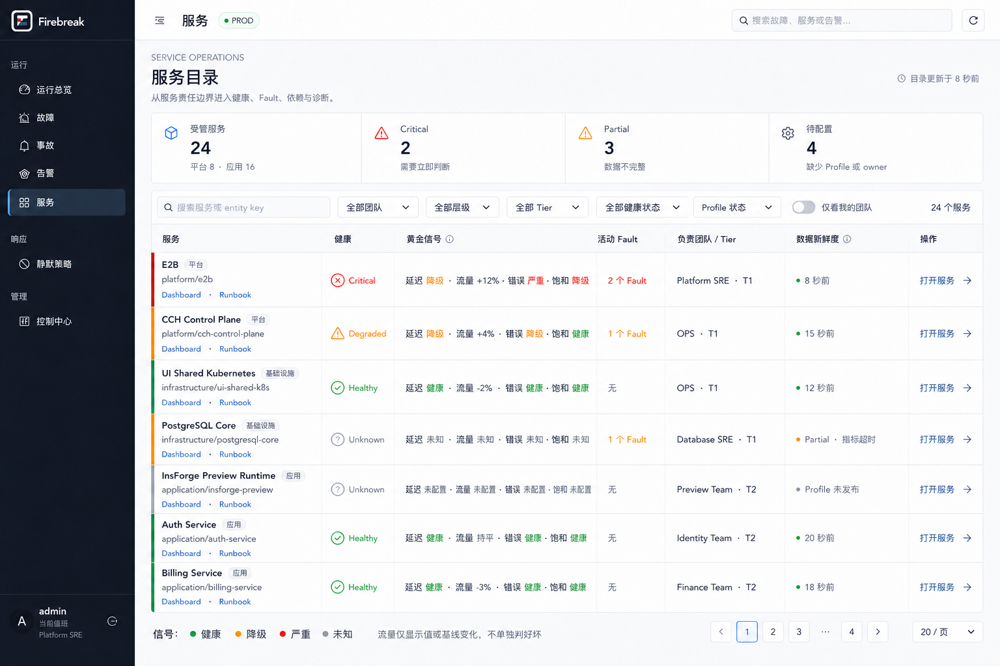
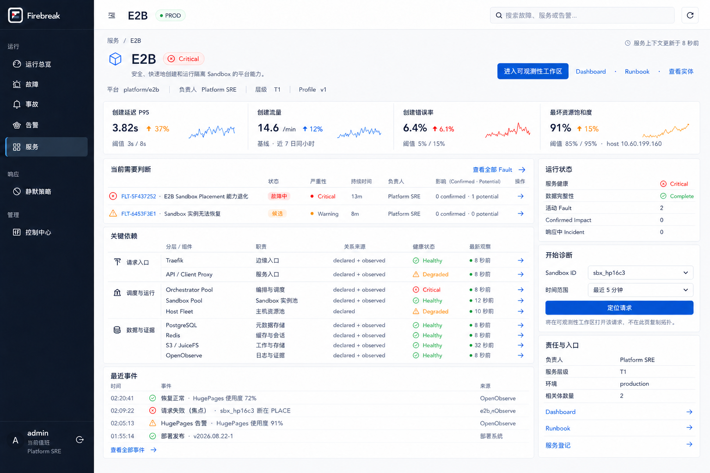
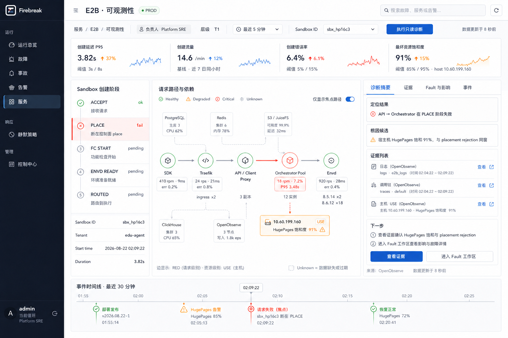

# `/services` 路由族页面与交互规范

> 状态：Proposed
> 日期：2026-08-22
> 完整交接稿：[Service Observability 完整设计与开发交接稿](2026-08-22-service-observability-complete-design-handoff.md)
> 依赖：[Service Observability Workspace 设计](2026-08-22-service-observability-workspace-design.md)
> 详细工作区：[页面与交互规范](2026-08-22-service-observability-page-spec.md)
> 范围：`/services`、`/services/:service_id` 与 `/services/:service_id/observability`；不包含前后端或 Agent 实现

## 1. 设计结论

`/services` 不是单一 Dashboard，而是一组逐级收敛调查范围的页面：

| 层级 | 核心问题 | 用户主动作 | 不承担的职责 |
|---|---|---|---|
| `/services` | 哪个服务现在最需要关注？ | 打开服务 | 不展示单次请求路径，不做根因判断 |
| `/services/:service_id` | 这个服务发生了什么，由谁负责，从哪里开始？ | 进入工作区或定位请求 | 不复制完整动态拓扑，不浏览原始证据 |
| `/services/:service_id/observability` | 哪一跳、哪个资源和哪些证据解释当前症状？ | 聚焦、下钻证据、关联 Fault | 不重建 Alert/Fault/Incident 状态机 |

三层共用 Service Registration、Service Observability Profile、信号语义和数据状态；差别只在调查范围与信息密度。

## 2. 视觉基准

### 2.1 服务目录

目录是高密度、可扫描的服务台账。它优先呈现异常、责任与数据可信度，不使用营销式卡片或脱离语义的综合评分。

### 2.2 E2B 服务总览

服务总览是稳定落点。它压缩展示 E2B 的四大黄金信号、当前 Fault、关键依赖、最近事件与诊断入口，但不在首屏复制完整拓扑。

### 2.3 E2B 可观测性工作区

工作区只在明确服务与时间范围后展开完整旅程、拓扑、RED、USE、证据和领域事件。

视觉稿是方向与验收参考；本文的状态语义、字段职责和交互规则为规范来源。生成图中文字若存在细微渲染误差，不应进入生产文案。

## 3. 全局 Shell 与导航连续性

三层使用同一 Firebreak shell：深色左导航、白色顶栏、浅灰工作画布、白色低圆角工作表面。页面切换不得改变导航结构或视觉语言。

### 3.1 面包屑

~~~text
服务
服务 / E2B
服务 / E2B / 可观测性
~~~

- 面包屑中的“服务”返回目录并恢复筛选、排序和滚动位置。
- “E2B”返回服务总览，并保留当前环境。
- 浏览器前进/后退必须恢复 URL 表达的时间窗和 focus。

### 3.2 跳转规则

| 来源 | 操作 | 目标 |
|---|---|---|
| 服务目录 | 点击服务行或“打开服务” | `/services/:service_id` |
| 服务总览 | “进入可观测性工作区” | `/services/:service_id/observability` |
| 服务总览 | 输入 focus 并“定位请求” | 工作区，并携带 focus 与时间窗 |
| 服务总览 | 点击 Fault | `/faults/:fault_id` |
| 服务总览/工作区 | 点击依赖实体 | `/infrastructure/:entity_id` |
| 工作区 | 点击 Fault/Incident | 既有 Fault/Incident 页面 |

目录行点击区域和行内 Dashboard、Runbook 等次级链接必须分离；使用次级链接时不能同时打开服务。

## 4. `/services` 服务目录

### 4.1 信息结构

1. 标题与一句话用途说明；
2. Managed、Critical、Partial、Unconfigured 摘要台账；
3. 搜索与 Team、Tier、Health、Data status 筛选；
4. 服务表格；
5. 信号状态与数据状态图例。

### 4.2 服务行字段

| 字段 | 含义 | 交互 |
|---|---|---|
| Service | 名称、说明与稳定 service_id | 点击打开服务总览 |
| Owner | owner team | 点击可筛选同团队 |
| Tier | 服务等级 | 点击可筛选同 tier |
| Health | Healthy / Degraded / Critical / Unknown | 仅由 profile 的有效信号派生 |
| Golden signals | 延迟、流量、错误、饱和度的紧凑摘要 | hover/focus 展示值、窗口和阈值来源 |
| Fault / Impact | active Fault 与 confirmed Impact 数量 | 点击进入预筛选领域列表 |
| Data | Complete / Partial / Stale / Unconfigured | 展示数据覆盖与新鲜度，不表达健康 |
| Observed | 最近成功观测时间 | 使用相对时间，详情展示绝对时间 |
| Action | 打开服务 | 唯一行级主动作 |

### 4.3 排序与筛选

默认排序采用可解释的分层规则，而不是神秘综合分数：

1. Health：Critical → Degraded → Unknown → Healthy；
2. confirmed Impact 数量降序；
3. active Fault 数量降序；
4. Tier：T0 → T1 → T2 → T3；
5. Service 名称升序。

用户可改按 Service、Owner、Tier、Health、Fault、Data 或 Observed 排序。筛选状态进入 query string，返回目录时保留。

### 4.4 健康与数据状态必须正交

| Health | Data | 正确解释 |
|---|---|---|
| Critical | Complete | 有足够数据确认严重异常 |
| Critical | Partial | 已有数据足以确认异常，但部分视图/证据缺失 |
| Unknown | Partial | 数据不足，当前不能判断健康 |
| Unknown | Unconfigured | 尚未建立可观测性 Profile 或关键绑定 |
| Healthy | Partial | 仅在剩余有效信号足以满足 profile 的健康判定时允许，并明确覆盖缺口 |

禁止把 Partial、Stale 或 Forbidden 直接转译成 Degraded/Critical；也禁止把“无活跃 Alert”自动转译成 Healthy。

### 4.5 空态与未治理状态

- 搜索无结果：保留筛选控件，提供“清除筛选”。
- `Unconfigured`：行仍可打开；总览展示 identity、owner、Dashboard/Runbook 和配置缺口，不伪造信号。
- 无权限：不泄露服务名称时从列表移除；可见服务但证据受限时保留服务行，并在 Data 中表达可见范围内的状态。
- 加载失败：保留上次成功列表但标为 Stale，并提供重试；不得把旧健康色当作当前结论。

## 5. `/services/:service_id` 服务总览

### 5.1 页面任务

服务总览在 10 秒内让值班人员回答：

1. 当前服务状态是否值得立即处理；
2. 是否已有 Fault、confirmed Impact 或 Incident；
3. 由谁负责、服务等级是什么；
4. 哪些关键依赖异常；
5. 是进入完整工作区，还是直接打开既有 Fault/Runbook。

### 5.2 首屏区域

| 区域 | 内容 | 设计约束 |
|---|---|---|
| Identity header | 名称、描述、环境、Health、owner、tier、Profile 版本 | “进入可观测性工作区”为唯一全局主动作 |
| Golden ledger | Latency、Traffic、Errors、Saturation | Traffic 使用中性色；每项显示窗口/基线或阈值 |
| Fault list | active/candidate Fault、严重性、持续时间、owner、影响 | 不在此页编辑 Fault 状态机 |
| Critical dependencies | 分层/组件、职责、关系来源、Health、Observed | 使用台账，不画缩小版拓扑 |
| Run status | Health、Data、Fault/Impact/Incident 数量 | Health 与 Data 分行 |
| Start diagnosis | focus kind/value 与时间窗 | 只构造工作区 URL，不在本页执行诊断 |
| Responsibility | owner、tier、环境、相关链接 | Dashboard/Runbook/登记为次级链接 |
| Recent events | 发布、Alert、Fault、恢复等 | 统一时间排序，标记来源 |

### 5.3 为什么总览不放完整拓扑

- 没有明确 focus 时，全量拓扑会混合结构关系与一次请求的实际路径；
- 小画布无法同时表达边 RED、节点 USE、Unknown 和证据状态；
- 总览的任务是判断与分流，不是深度调查；
- 同一拓扑在两页重复会产生状态、缩放和交互实现分叉。

因此总览只显示关键依赖台账；完整 topology renderer 只存在于工作区。

### 5.4 启动诊断

E2B 默认 focus kind 为 `sandbox_id`。用户输入 `sbx_hp16c3`、选择最近 5 分钟后，跳转为：

~~~text
/services/svc_e2b_fixture/observability
  ?focus_kind=sandbox_id
  &focus_value=sbx_hp16c3
  &from=...
  &to=...
~~~

- 输入只接受 profile 声明的 focus kind 和格式；
- URL 不包含 token、查询语句或证据正文；
- 工作区服务端必须根据当前用户重新鉴权；
- 无 focus 也可进入工作区，此时显示服务级默认拓扑，不伪造单次请求路径。

## 6. `/services/:service_id/observability` 工作区

详细布局、状态、键盘交互与响应式规则见[工作区页面与交互规范](2026-08-22-service-observability-page-spec.md)。路由族只规定以下边界：

- 继承服务总览的 service、environment 与权限上下文；
- URL 可表达 focus 与绝对时间范围；
- Golden 属于服务级，RED 属于服务/调用边，USE 属于资源节点；
- declared topology 与 observed path 必须视觉区分；
- Partial、Unknown、Stale、Forbidden 不得静默转绿；
- Fault/Impact/Incident 只引用 canonical 领域对象；
- Agent 未确定前，不出现 AI 页签、聊天框、置信度或 Agent 操作。

## 7. 跨页数据与状态连续性

### 7.1 单一语义来源

三页不得分别计算 Health。服务端 View Model 应提供同一 `health_summary`、`data_status`、`observed_at` 与阈值解释；各页只选择不同密度展示。

### 7.2 时间状态

- 目录使用 profile 默认近期窗口；
- 总览默认沿用目录环境并使用 profile 默认窗口；
- 工作区允许用户选择明确时间范围；
- 从工作区返回总览时，总览不应把历史时间范围冒充“当前状态”；若保留历史窗口，必须明显显示“历史视图”。

### 7.3 加载与局部失败

- Identity/ownership 优先返回；
- Health、Golden、Fault、dependencies 可分块加载；
- 单块失败只影响该块，页面状态变为 Partial；
- 权限拒绝只作用于受限字段或证据类型，不升级为整页 403，除非用户无权访问该服务本身。

## 8. 响应式与可访问性

- 设计基准为 1440px 及以上桌面运维场景；
- 1024–1439px：右栏移到主内容下方，服务表允许横向滚动，关键列 sticky；
- 小于 1024px：支持查看与基础跳转，不保证完整拓扑编辑体验；
- 所有状态同时使用文字/图标/颜色，不以颜色为唯一信息；
- 表头支持键盘排序，行内动作可独立聚焦；
- sparkline 具有可读文本替代；
- 相对时间可聚焦显示绝对时间、时区与 `observed_at`。

## 9. Phase 1 视觉与交互验收

### 9.1 服务目录

- [ ] 可在同一行区分 Health 与 Data；
- [ ] 默认排序可解释且异常服务优先；
- [ ] Traffic 上升不自动显示危险色；
- [ ] Unknown、Partial、Unconfigured 均有明确解释；
- [ ] 筛选、排序和返回位置可恢复。

### 9.2 服务总览

- [ ] 首屏明确 owner、tier、Health、Data 和当前领域对象；
- [ ] 四大黄金信号显示窗口、基线或阈值；
- [ ] 关键依赖使用台账，不复制完整拓扑；
- [ ] focus 启动器生成可分享但不含敏感信息的 URL；
- [ ] Dashboard、Runbook、Fault、实体均深链到 canonical 页面。

### 9.3 工作区

- [ ] 通过已定义的主状态、Partial + Unknown、Forbidden 三类视觉验收；
- [ ] RED/USE/Golden 的对象归属正确；
- [ ] declared 与 observed 关系可区分；
- [ ] 单个来源失败不会造成整页失败或假绿；
- [ ] 页面没有尚未确定的 Agent UI 或隐性 Agent 依赖。

## 10. 本阶段明确不做

- 不实现页面、API、轮询、SSE 或缓存；
- 不实现通用 Dashboard builder 或服务自定义前端插件；
- 不实现 Agent、模型选择、prompt、聊天会话或写操作 tools；
- 不在 `/services` 内复制 Alert/Fault/Impact/Incident 状态机；
- 不把 E2B 专属阶段硬编码进平台通用 renderer。
