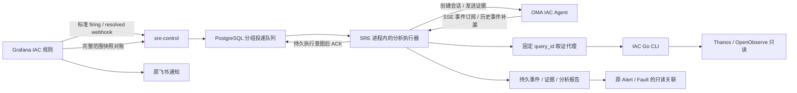

# IAC 告警自动分析实施与验收

目标：Grafana 使用 sre-control 提供的 webhook；sre-control 持久化告警及分析任务，自动触发 OMA Agent，并订阅 OMA 会话事件。固定 IAC Go PRO 只读查询提供证据，最终分析报告持久化并关联原 Alert/Fault。Issue #22 跟踪联合上线，不以任务 ACK 或 OMA idle 代替完成。

## 当前事实与范围

- 产品基线 `fb505a2b2d1130407c319f7a4b2ff49cc52cec4a` 已部署 Firebreak dev，发布验收见 PR #21。
- 当前 IAC 为 Go PRO：appId `80beff42ab0b41819f9c1c3c3ac95413308e70eb`，cluster `60`，namespace `iac-pro-pro`。CCloud 归属团队为“IT-平台-IAC”；其平台 ID 不能当 SRE UUID 使用。
- Grafana 已启用 7 条 Go 与 3 条共享规则，5 条旧 Node 规则暂停。接入前实时活跃告警为 0，不能沿用旧的映射覆盖率分母。
- `itapis.cvte.com` 的 `/iac` 前缀路由指向该 Go 应用；整个域名有 19 条路由，其中另外 18 条不属于本次 IAC 范围。
- 11 月 14 日 Demo 已验证固定 JSON 取证请求、程序代查和同会话第二轮分析；未完成常驻执行与持久报告。原生沙箱工具曾失败；本轮重新探测已验证 Node 与 bash 可用。告警主链仍沿用已设计和测试的固定代理取证方式，日报补 CLI 另由 #27 跟踪。
- 本机 Go CLI 源码位于 `iacctl/golang/iacctl`；Node CLI 的旧 VM/PM2 图不能代表当前 Go 拓扑。Go pack 的历史期望副本数 5 不是当前运行实测。

## 运行链路

OMA 原生工具关闭；模型只提交受控查询 ID。取证代理固定 PRO、appId、namespace 和查询模板，不接受模型提供的 shell、SQL、URL、凭据或环境选择。查询失败、缺样本、非有限值、超时保持 unknown。模型报告仅 advisory，不自动确认 Impact、宣布 Incident 或修改 Fault。

当前实例已验证 SSE 路径 `/v1/sessions/{id}/events/stream`。事件 ID 唯一去重，业务处理和 cursor 持久化；`Last-Event-ID` 不作为可靠回放保证，断线使用分页历史事件重叠补漏。未核实通用 webhook 注册与验签契约前，不虚构 OMA 回调 API。

## Issue 与 PR 划分

| 工单 | 交付 | 必须通过的验收 |
|---|---|---|
| #23 | Grafana Source 范围、原生分组、稳定 rule_id、对账补分析 | 混合业务隔离；scope 不完整或改变不误解除；同 occurrence 的 webhook/快照/重投不重复执行；Alertmanager 兼容 |
| #24 | 常驻分析执行器、持久阶段、事件订阅与报告 API | ACK 前后重启；POST 结果未知查回而不盲重发；SSE 重放/断连；报告幂等；角色及管理员读取隔离；不写领域状态 |
| #25 | IAC 取证代理、技能边界及可复现构建 | query_id 白名单；固定环境；超时/输出上限；凭据不输出；空值/错误 unknown；CLI 版本与二进制摘要可查 |
| #22 | 联合发布、Grafana 路由与真实验收 | Grafana 自动触发真实 OMA、真实 IAC 证据、同会话报告落库；清理 canary 后保留常驻链路 |

## 来源、规则与映射

Grafana Source 使用 `product=IAC` 与明确规则 ID 范围。稳定公开标签 `sre.rule.id` 由规则配置提供，只将明确白名单字段放进机器协议。查询表达式中的 appId、pod 等选择器不等于 webhook 实际包含的标签，不使用不存在的字段作为 correlation label。

| rule_id | 映射语义 | 分析限制 |
|---|---|---|
| iac-go-system-errors | 应用系统错误率，direct_impact | 排除正常业务拒绝，不能推定平台根因 |
| iac-go-latency-p99 | 应用延迟退化，direct_impact | 进程内 p99，不能冒充端到端 SLO |
| iac-go-traffic-zero | symptom | 零流量不单独证明服务不可用 |
| iac-go-metrics-stale | supporting | 观测缺失不确认业务受损 |
| iac-go-commit-unknown | supporting | 提交结果未知，禁止自动重放事务 |
| iac-go-outbox-dead | supporting | 审计故障不等同鉴权服务不可用 |
| iac-go-outbox-lag | supporting | 共享库 max 不能逐 pod 累加 |
| iac-api-probe-not-all-200 | supporting | 必须区分实际探测失败与没有样本 |
| iac-api-probe-delay-high | supporting 起步 | 需真实有效五地测量，Go 指标不能证明外部入口正常 |
| iac-redis002-vip-ras-down | supporting | VIP 探测和应用 Redis 超时是不同证据 |

映射同时限定来源、稳定 rule_id 和原正常 `alertname`；Grafana 的 `DatasourceNoData` / `DatasourceError` 即便带原 rule_id，也不能继承业务 direct_impact。未知归属事件不能被范围过滤伪装成完整空快照。

正式 IAC 服务以当前 CCloud appId alias 绑定 owner 与 `pro` 环境。入口、Redis、MySQL 的依赖只在唯一资源身份与依赖语义核实后添加；本轮自动分析不依赖猜测拓扑，不修改 E2B 存量关系。

## 发布与真实验收

1. 合并通过审查/CI 的实现，记录联合源码 SHA、API/migrate 镜像 digest 与 CLI SHA。迁移前核实实际账本，不猜测版本。
2. 配置专用 OMA Agent/environment，禁用原生工具，记录版本及 prompt 摘要。复用现有平台配置和 OMA Vault 管理凭据，不放 prompt、Git、日志或命令行；不新增 Kubernetes Secret。现有管理员凭据不得在未经明确授权时转存到其他服务。
3. 在 Firebreak dev 的现有 API 进程中启用有界分析执行器，沿用已有服务发布流程。新增 Grafana Source、IAC 目录和精确 mapping；原飞书 route/contact 保留，新增并行 SRE receiver。对账 token 单独绑定环境变量。独立 worker 命令仅保留为可选部署入口，本轮不新增该 workload。
4. 使用独立 IAC canary 规则，实际经 Grafana 通知引擎投递。核对 webhook、Alert、分析投递、OMA session、真实查询证据及持久报告的关联；记录事件订阅及 final event ID。
5. 测试重投、恢复、worker 重启和事件补漏。隔离测试覆盖模型错误、取证错误、超时及提交未知；生产 IAC 不制造真实故障，不修改正常业务阈值来强迫 firing。
6. 删除/停用临时 canary、临时管理员和测试凭据，回读线上配置与分析执行器健康，确认正常 10 条规则继续自动路由。保留脱敏审计证据。

回退先停 worker 并禁用新增 SRE 子路由，保留原飞书；数据库记录与分析证据保留，不自动执行 down 迁移。恢复前按持久状态查回会话，不能因回退重建重复 OMA 会话。

本文件是实施契约；逐项完成证据写入独立验收文档。健康证据自动归因仍归 #14，通用客户端持久 inbox 仍归 #15，均不因本次托管 worker 上线而自动宣称完成。
